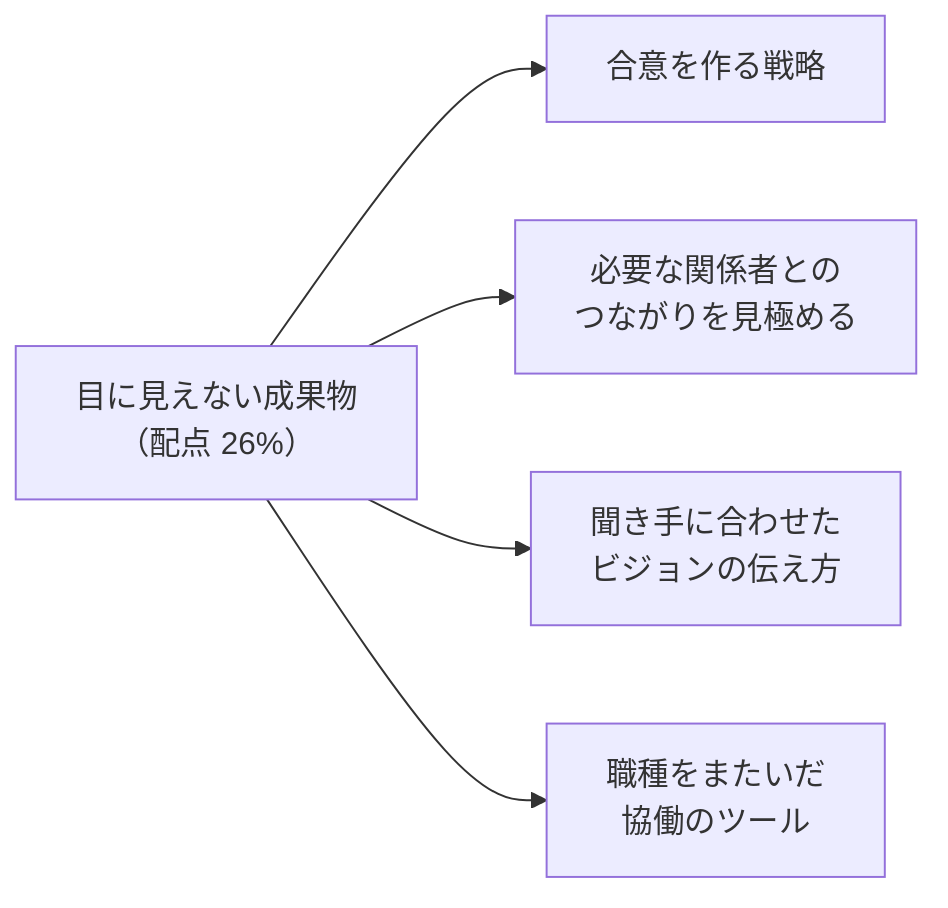
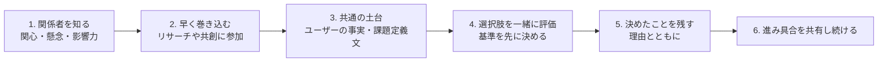
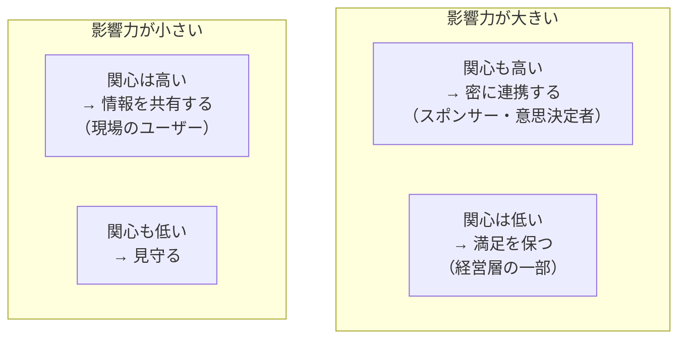

## はじめに：この範囲で学ぶこと

「目に見えない成果物」は配点 **26%** です。

戦略デザインの成果は、資料や図だけではありません。

| 目に見えない成果物 | 意味 |
|---|---|
| **合意（アライメント）** | 何を目指し、何を優先するかについての共通理解 |
| **信頼関係** | 経営層・現場・IT・顧客との関係 |
| **共通の言葉** | 課題やビジョンを同じ意味で語れる状態 |
| **当事者意識** | 関係者が「自分たちの取り組み」と感じている状態 |
| **勢い** | 前に進む空気、期待 |

---

## 1. 合意を作る戦略

### 1-1. 合意を作る流れ

| ポイント | 内容 |
|---|---|
| **早く巻き込む** | 完成した案を見せて承認を求めるより、作る過程に参加してもらう |
| **事実を共通の土台に** | 意見がぶつかったら、ユーザーの声やデータに立ち返る |
| **立場より、根底のニーズ** | 「A 案がいい」の裏にある本当の懸念（予算、仕事が増える不安など）を聞く |
| **評価の基準を先に決める** | 「何を重視して選ぶか」に先に合意すると、案の比較が公平になる |
| **決めたことと理由を残す** | 決定の記録、ビジョンボード。後から蒸し返されにくい |
| **小さな成功を見せる** | クイックウィンで信頼と勢いを作る |

例：対立する要望

営業部長は「入力項目を減らしたい」、経営企画は「分析のために項目を増やしたい」。
→ 根底のニーズを聞くと、営業は「顧客と話す時間を増やしたい」、経営企画は「正確な売上の見込みがほしい」。
→ 「**入力の手間を増やさずに、見込みの精度を上げる**」を共通の目標にし、自動取得や AI での入力補助を検討する。

---

## 2. 必要な関係者とのつながりを見極める

### 2-1. 関係者マップ

| 関係者の役割 | 意味 | 関わり方 |
|---|---|---|
| **スポンサー** | 予算と権限で取り組みを支える | 定期的に成果と課題を報告、判断を仰ぐ |
| **意思決定者** | 方向性を決める | 判断の材料（選択肢と根拠）を用意 |
| **推進役（チャンピオン）** | 現場で取り組みを広める | 早く巻き込み、意見を設計に反映 |
| **影響力のある人** | 公式の役職がなくても周りに影響する | 懸念を聞き、味方になってもらう |
| **抵抗しそうな人** | 変化で不利益を感じる | 理由を聞き、懸念に対応する |

### 2-2. 力学の変化に合わせる

- 組織変更、担当者の異動、予算の見直しで、**関係者の力関係は変わります**。
- スポンサーが交代したら、**新しいスポンサーにもう一度価値を説明**し、合意を取り直します。
- 課題定義文を解くために**本当に必要な関係者**（データを持っている部門、承認を握る人）を見極め、関係を作ります。

---

## 3. 聞き手に合わせたビジョンの伝え方

### 3-1. 聞き手ごとのポイント

| 聞き手 | 関心 | 伝え方 |
|---|---|---|
| **経営層** | 事業の成果、投資対効果、リスク、競争力 | 結論から。指標と効果の見込み、ユーザーの声を短く添える |
| **現場のユーザー** | 自分の仕事がどう良くなるか | 具体的な場面のストーリー、プロトタイプを触ってもらう |
| **IT・技術チーム** | 実現方法、既存システム、セキュリティ | 構成の考え方、制約とトレードオフ |
| **財務** | コストと効果の根拠 | 数字の前提と試算 |
| **顧客・パートナー** | 自分にとっての便利さ | 体験の変化を具体的に |

### 3-2. 伝える手法

| 手法 | 内容 |
|---|---|
| **ストーリーテリング** | 現状（ユーザーの困りごと）→ ビジョン（あるべき姿）→ 道筋（ロードマップ）の流れで語る |
| **ペルソナの「1 日」** | 将来、あるユーザーの 1 日がどう変わるかを描く |
| **ビジョンのプロトタイプ** | 将来の画面や体験を、動くもの・見えるもので示す（言葉より速く伝わる） |
| **ジャーニーマップの比較** | 現状と将来のジャーニーを並べる |
| **データとユーザーの声** | 数字（効果の大きさ）と生の声（共感）をセットに |
| **ビジョンステートメント** | 目指す姿を短い言葉に |

「見せる」は「話す」より強い

抽象的な説明より、**プロトタイプやストーリー**で具体的に見せると、聞き手が自分のこととして想像できます。特に、関係者の立場がばらばらなときに効果的です。

---

## 4. 職種をまたいだ協働のツール

| ツール | 使い方 |
|---|---|
| **共有の成果物** | ペルソナ、ジャーニーマップ、サービスブループリント、課題定義文を全員の「共通の地図」にする |
| **デジタルホワイトボード** | 離れた場所でも一緒に描く・整理する |
| **チャット・共同編集**（Slack など） | 日々のやりとり、決定の共有 |
| **決定の記録** | 何をなぜ決めたかを残す（後から加わった人も追える） |
| **用語集** | 職種ごとに違う言葉の意味をそろえる |
| **定期的な共有の場** | デモ、振り返り、ショーケース |
| **RACI** | 誰が実行・説明責任・相談・報告を受けるかを明確に |

- デザイナー、ビジネスアナリスト、アーキテクト、開発者は、**使う言葉も成果物も違います**。共有の成果物と用語集で、**同じものを見ながら話せる**ようにします。

### 4-1. ワークショップのファシリテーション

| ポイント | 内容 |
|---|---|
| **目的とゴール** | 最初に「何を決めるか・何を持ち帰るか」を示す |
| **発散と収束を分ける** | アイデアを広げる時間と、絞る時間を分ける |
| **発言の偏りを防ぐ** | 個人で書いてから共有、匿名の投票、少人数のグループ |
| **時間の管理** | 時間を区切り、脱線したら「後で話す」リストへ |
| **次のアクション** | 最後に、誰が何をいつまでにやるかを決める |

---

## 5. 変化への抵抗に向き合う

| 抵抗の理由 | 対応 |
|---|---|
| **理解していない** | なぜ変えるのか、ユーザーと事業にとっての意味を説明 |
| **不安**（できるか、仕事がなくなるか） | トレーニング、段階的な導入、役割の変化を一緒に考える |
| **得をしない** | その人にとっての利点を見つける、負担を減らす工夫 |
| **過去の失敗** | 小さく始めて成功を見せる |

---

## 6. まとめ

| テーマ | 覚えること |
|---|---|
| 目に見えない成果物 | 合意、信頼関係、共通の言葉、当事者意識、勢い |
| 合意 | 早く巻き込む、事実を土台に、根底のニーズ、基準を先に、決定を残す、小さな成功 |
| 関係者 | 影響力 × 関心のマップ。スポンサー・意思決定者・推進役・抵抗する人 |
| 力学の変化 | スポンサーの交代などで合意を取り直す |
| 伝え方 | 聞き手の関心に合わせる。ストーリー、プロトタイプ、データと声 |
| 協働 | 共有の成果物、ホワイトボード、決定の記録、用語集、RACI |
| ファシリテーション | 目的、発散と収束、偏りを防ぐ、時間、次のアクション |

## 試験直前チェック

- [ ] 目に見えない成果物を 4 つ言える
- [ ] 対立する要望から合意を作る方法を説明できる
- [ ] 関係者マップの 4 つの区分と関わり方を言える
- [ ] スポンサーが交代したときにすべきことを言える
- [ ] 経営層と現場のユーザーへの伝え方の違いを言える
- [ ] 職種をまたいだ協働に役立つツールを 4 つ言える
- [ ] ワークショップで発言の偏りを防ぐ工夫を言える
