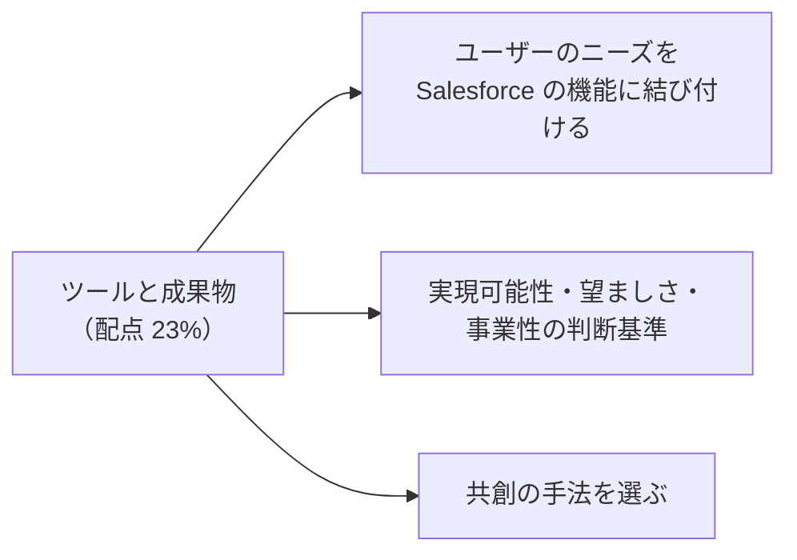
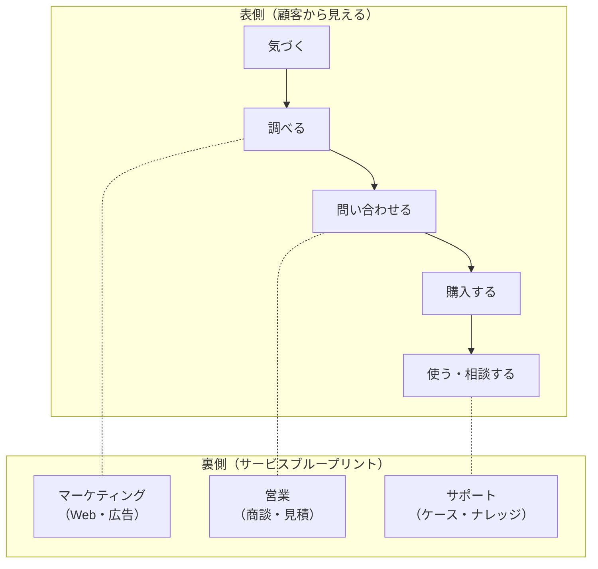
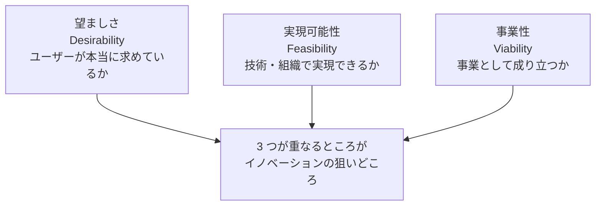

## はじめに：この範囲で学ぶこと

「ツールと成果物」は配点 **23%** です。

---

## 1. ユーザーを理解するツール

### 1-1. リサーチの手法

| 手法 | 分かること | 向いている場面 |
|---|---|---|
| **インタビュー** | 動機、不満の背景、考え方 | 「なぜ」を深く知りたい |
| **観察（シャドーイング・現場訪問）** | 実際の行動、言葉にされない手間や工夫 | 本人も気づいていない課題を見つけたい |
| **アンケート** | 多くの人の傾向（量的） | 仮説がどれくらい当てはまるか確かめたい |
| **既存データの分析** | 利用状況、ログ、問い合わせの内容 | 事実に基づいて課題の大きさを測りたい |
| **日記調査** | 一定期間の行動と感情の変化 | 長い期間にわたる体験を知りたい |

- 人は自分の行動を正確に説明できないことが多いので、**聞く**だけでなく**観察する**ことが大切です。
- 集めた情報は**親和図**（アフィニティダイアグラム：似たものをグループにまとめる）で整理し、パターンを見つけます。

### 1-2. 成果物（アーティファクト）

| 成果物 | 内容 | 使いどころ |
|---|---|---|
| **ペルソナ** | リサーチに基づく代表的なユーザー像（目的・行動・不満） | 誰のために作るかを共有 |
| **共感マップ** | ユーザーが「言う・考える・する・感じる」こと | ユーザーの内面を理解 |
| **カスタマージャーニーマップ** | 顧客がサービスと関わる流れを段階ごとに（行動・感情・接点・課題） | 体験の中の「痛み」を見つける |
| **サービスブループリント** | ジャーニーの**裏側**（担当者・システム・プロセス）まで描く | 社内の仕組みのどこを変えるべきか |
| **課題定義文** | 解くべき問い | 判断の基準 |
| **ビジョン（プロトタイプ・ストーリー）** | 将来の姿を具体的に | 合意を作る |
| **ロードマップ** | 段階的な実現の計画 | 実行への橋渡し |

ひっかけ注意

- ペルソナは**想像の理想像ではなく、リサーチの事実**に基づいて作ります。
- 「顧客から見える体験」だけでなく「**社内の担当者やシステム**」まで描きたい → **サービスブループリント**。

---

## 2. ユーザーのニーズを Salesforce の機能に結び付ける

この段階では、細かい設計ではなく、**大まかな機能（ケイパビリティ）**で方向性を示します。詳しい設計は、アーキテクトやビジネスアナリストと一緒に詰めます。

| ユーザーのニーズ | Salesforce の大まかな機能 |
|---|---|
| 顧客の全体像を 1 か所で見たい | 取引先と関連情報（Sales Cloud・Service Cloud）、Data 360 |
| 外出先で情報を見て、すぐ記録したい | Salesforce モバイルアプリ |
| 繰り返しの作業を減らしたい | Flow による自動化、承認プロセス |
| 問い合わせを自分で解決したい | Experience Cloud のヘルプセンター、ナレッジ、AI エージェント |
| 24 時間すぐに対応してほしい | Agentforce（サービスエージェント）、メッセージング |
| 状況を数字で把握したい | レポート・ダッシュボード、Tableau |
| 一人ひとりに合った案内がほしい | Data 360 のセグメント、Marketing Cloud |
| 社内の情報をすぐ見つけたい | 検索、ナレッジ、従業員エージェント |
| 他のシステムと二重入力したくない | 連携（MuleSoft、API） |

機能から入らない

「Agentforce を使いたい」から始めるのではなく、「**ユーザーのどの課題を解決するか**」から始め、その解決に合う機能を選びます。機能はあくまで手段です。

---

## 3. 実現可能性・望ましさ・事業性

| 観点 | 判断の基準の例 | 確かめ方 |
|---|---|---|
| **望ましさ** | ユーザーの課題を解決するか、使いたいと思うか、今のやり方より良いか | ユーザーテスト、プロトタイプへの反応、インタビュー |
| **実現可能性** | 技術的に作れるか、データはあるか、スキル・体制・期間は足りるか、既存システムと合うか | アーキテクトの確認、技術的な検証（PoC） |
| **事業性** | 投資に見合う効果があるか、収益・コストの見込み、戦略に合うか、継続して運用できるか | 費用対効果の試算、指標の見込み |

- 3 つのうち 1 つでも欠けると、うまくいきません（使われない、作れない、続かない）。
- 案を比べるときに、**3 つの観点の基準を先に決めておく**と、関係者と公平に評価できます。

評価の例

案：「顧客がアプリで写真を送ると、AI が故障の原因を判定する」
- 望ましさ：顧客は電話で説明する手間が省ける → 高い
- 実現可能性：判定に使える過去の写真データが少ない → 低い（まずデータを集める段階が必要）
- 事業性：訪問修理の件数を減らせる → 高い
→ すぐに全面導入ではなく、**データを集める段階**からロードマップに入れる。

---

## 4. 共創の手法を選ぶ

**共創（コ・クリエーション）** は、顧客やステークホルダーと**一緒に**考えて作ることです。当事者意識が生まれ、合意も作りやすくなります。

| 手法 | 内容 | 向いている場面 |
|---|---|---|
| **ジャーニーマップづくりのワークショップ** | 関係者で現状の体験を一緒に描く | 部門ごとに見えている課題が違う |
| **アイデア出し（ブレインストーミング）** | 批判せずに量を出し、その後に絞る | 新しい解決策を広く集めたい |
| **「どうすれば」の問いづくり** | 課題を前向きな問いに変える | 課題から解決の方向に移るとき |
| **優先順位付け（マトリックス・投票）** | 効果 × 実現しやすさなどで並べる | 多くの案から絞り込む |
| **ペーパープロトタイピング** | 紙で画面や流れを一緒に描く | 早く安く形にして話し合いたい |
| **デザインスプリント** | 数日で課題定義からプロトタイプのテストまで行う | 短期間で方向性を確かめたい |
| **カードソート** | 情報の分類をユーザーにしてもらう | メニューやナビゲーションの構成 |
| **ロールプレイ・寸劇** | 将来の体験を演じてみる | サービスの流れを体感して確かめる |
| **良い点・悪い点・芽（ローズ・ソーン・バッド）** | 現状の良い点、問題、可能性を出す | 振り返り、現状の評価 |

### 4-1. 選び方

| 状況 | 選ぶ手法 |
|---|---|
| まだ課題がはっきりしない | ジャーニーマップづくり、インタビューの共有 |
| 案を広げたい | アイデア出し、「どうすれば」の問い |
| 案を絞りたい | 優先順位のマトリックス、投票 |
| 案を形にして確かめたい | ペーパープロトタイピング、ロールプレイ |
| 時間が短く、決めることが多い | デザインスプリント |
| 参加者の立場の差が大きい（上司と部下） | 個人で書いてから共有、匿名の投票 |
| リモートで行う | デジタルホワイトボード、事前の準備 |

### 4-2. プロトタイプの忠実度

| 忠実度 | 例 | 確かめること |
|---|---|---|
| **低い** | 紙のスケッチ、付せん | 考え方・流れが合っているか |
| **中くらい** | 画面のワイヤーフレーム | 情報の配置、手順 |
| **高い** | 実際の Salesforce の画面（サンドボックス）、作り込んだモックアップ | 使い勝手、細かい表現 |

- **早い段階ほど低い忠実度**で、たくさん試します。作り込みすぎると、捨てにくくなり、意見も出にくくなります。

---

## 5. まとめ

| テーマ | 覚えること |
|---|---|
| リサーチ | インタビュー、観察、アンケート、データ分析、日記調査。親和図で整理 |
| 成果物 | ペルソナ、共感マップ、ジャーニーマップ、サービスブループリント、課題定義文、ビジョン、ロードマップ |
| 機能との結び付け | 課題から始め、大まかな機能で方向性を示す。詳細は専門の役割と |
| 3 つの観点 | 望ましさ（ユーザー）、実現可能性（技術・組織）、事業性（事業） |
| 共創 | ジャーニーマップづくり、アイデア出し、優先順位付け、ペーパープロトタイピング、デザインスプリント |
| 忠実度 | 早い段階は低く、確かめたいことに合わせる |

## 試験直前チェック

- [ ] インタビューと観察の違いと使い分けを言える
- [ ] ジャーニーマップとサービスブループリントの違いを言える
- [ ] ユーザーのニーズを Salesforce の機能に結び付けた例を 3 つ言える
- [ ] 望ましさ・実現可能性・事業性の基準と確かめ方を言える
- [ ] 状況に応じて共創の手法を選べる
- [ ] プロトタイプの忠実度の選び方を言える
