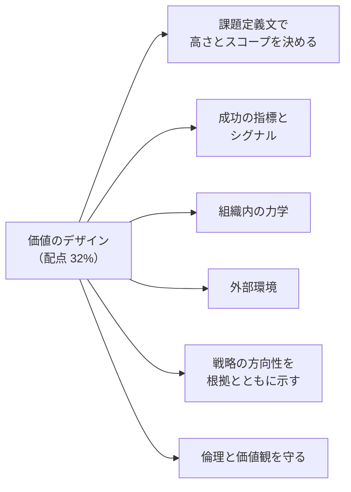
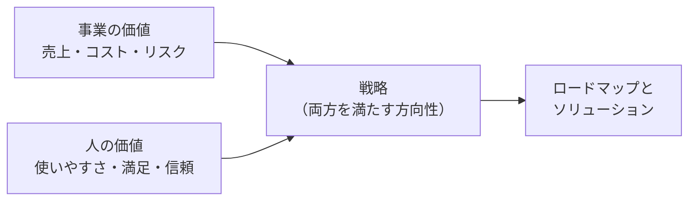
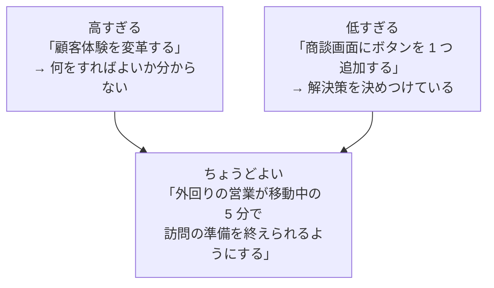
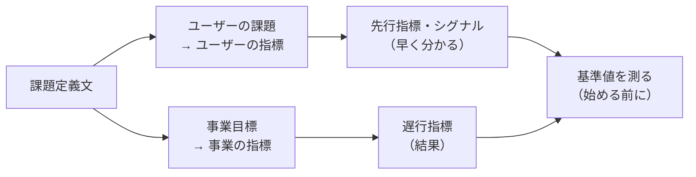

## はじめに：この範囲で学ぶこと

「価値のデザイン」は配点 **32%** で、この試験で最も大きい範囲です。

この資格の受験言語

Platform Strategy Designer は**英語のみ**で受験します（2026 年 10 月時点）。重要な用語は英語も一緒に覚えましょう（例：課題定義文＝Challenge Statement、高さ＝Altitude）。

---

## 1. 戦略デザイナーの役割

**戦略デザイナー（Strategy Designer）** は、「**何を作るか**」の前に「**なぜ作るのか、誰のためか、何をもって成功とするか**」を明らかにし、関係者の合意を作る役割です。

- **事業の価値**と**人（ユーザー）の価値**の**両方**を満たす解決策を目指します。片方だけでは長続きしません。
- デザイン思考の流れ（**共感 → 問題定義 → アイデア → プロトタイプ → テスト**）を、行き来しながら進めます。

---

## 2. 課題定義文（チャレンジステートメント）

### 2-1. 形

課題定義文は、**事業目標**と**ユーザーの課題**を組み合わせて、プロジェクトが解くべき問いを 1 文で表したものです。

> **どうすれば**［ユーザー］が［ユーザーの課題］を解決できるようにし、**その結果**［事業目標］を達成できるか？

| 要素 | 例 |
|---|---|
| ユーザー | 外回りの営業担当者 |
| ユーザーの課題 | 移動中に商談の準備ができず、訪問前に慌てて資料を探している |
| 事業目標 | 訪問あたりの成約率を上げる |
| 課題定義文 | 「どうすれば、外回りの営業担当者が移動中の 5 分で訪問の準備を終えられるようにし、その結果、訪問あたりの成約率を上げられるか？」 |

### 2-2. 高さ（Altitude）とスコープ

| 高さ | 問題 | 直し方 |
|---|---|---|
| **高すぎる**（抽象的） | 範囲が広すぎて、何から手をつけるか決まらない。成功を測れない | 誰の、どんな場面の課題かを絞る |
| **低すぎる**（具体的） | **解決策を決めつけている**。もっと良い方法を見逃す | 「なぜそのボタンが必要か」と問い、根本の課題に上げる |
| **ちょうどよい** | 誰の何の課題かがはっきりし、いくつもの解決策を考えられる | — |

ひっかけ注意

課題定義文に**特定の機能や製品名**（「Agentforce を導入して」「ダッシュボードを作って」）が入っていたら、高さが**低すぎる**サインです。課題定義文は「何を解決するか」を表し、「どう解決するか」は含めません。

### 2-3. 根拠はリサーチ

- 課題定義文は、思い込みではなく**ユーザーへの調査（インタビュー・観察・データ）**で分かった事実から作ります。
- 関係者と一緒に作り、**合意**しておくと、後の判断の基準になります。

---

## 3. 成功の指標とシグナル

### 3-1. 指標の種類

| 種類 | 意味 | 例 |
|---|---|---|
| **事業の指標** | 事業目標の達成度 | 成約率、売上、解約率、コスト |
| **ユーザーの指標** | ユーザーの課題がどれだけ解決したか | 準備にかかる時間、満足度、タスクの完了率 |
| **先行指標** | 早い段階で変化が見える | 新しい機能の利用率、入力率 |
| **遅行指標** | 結果として後から分かる | 四半期の売上、年間の解約率 |
| **シグナル** | 数字になる前の**兆し**（定性的なものも） | 現場の声、問い合わせの変化、使い方の観察 |

### 3-2. 決め方

- 指標は**課題定義文から導きます**（ユーザーの課題 → ユーザーの指標、事業目標 → 事業の指標）。
- **始める前に基準値を測ります**。比べる値がないと、成果を示せません。
- 遅行指標だけだと結果が分かるまで時間がかかるので、**先行指標やシグナル**で早めに方向を確かめます。
- 測れない指標、測るのに手間がかかりすぎる指標は避けます。

---

## 4. 組織内の力学

同じ課題でも、組織の状況によって**取るべきアプローチ**が変わります。

| 力学 | 確認すること | アプローチへの影響 |
|---|---|---|
| **権力と意思決定** | 誰が決めるのか、予算を持っているのは誰か | 決める人を早く巻き込む |
| **部門間の関係** | 協力的か、対立しているか | 共通の目標を見つけ、対立を避ける進め方 |
| **組織文化** | 失敗を許すか、慎重か | 慎重な組織では小さな実験から |
| **変化への準備度** | 過去の変革で疲れていないか | 負担の小さい段階的な導入 |
| **スキルと体制** | 社内に推進できる人がいるか | 外部の支援、育成の計画 |
| **既存の投資** | 既存システムへの思い入れ | 既存の資産を活かす案 |

例

営業部門と IT 部門の関係が悪く、前回のシステム導入が失敗している組織。→ いきなり大きな変革を提案するより、**両部門が一緒に参加する小さなプロトタイプ**から始め、成功体験と信頼を作るアプローチを勧める。

---

## 5. 外部環境（イノベーションの文脈）

| 観点 | 例 | 戦略への影響 |
|---|---|---|
| **市場・顧客の変化** | 顧客がチャットやセルフサービスを好むようになった | デジタルの接点を重視 |
| **競合** | 競合が AI で即日回答を始めた | 対応の速さが差別化の条件に |
| **技術の変化** | 生成 AI、エージェント、データ基盤の進歩 | 新しい技術で何ができるかを検討 |
| **規制・法令** | 個人情報の保護、AI の規制 | データの使い方と AI の使い方に制約 |
| **社会・経済** | 人手不足、働き方の変化、景気 | 自動化・省力化の重要度 |

- 外部環境を見ることで、**今の課題だけでなく将来の課題**にも備えた方向性を示せます。
- 外部の変化は、関係者を説得する**根拠**にもなります（「競合はすでに始めている」）。

---

## 6. 戦略の方向性を根拠とともに示す

戦略の方向性を提案するときは、**なぜそれがよいのか**を説明できる必要があります。

| 説明すること | 内容 |
|---|---|
| **ユーザーのニーズ** | どのユーザーのどの課題を解決するか（リサーチの証拠） |
| **事業のニーズ** | どの事業目標にどう貢献するか（指標） |
| **選ばなかった案** | 他の案と比べて、なぜこれを選んだか |
| **将来への影響** | 今の選択が将来どう効いてくるか（拡張性、次の段階、二次的な影響） |
| **リスクと前提** | 何が前提で、外れたらどうなるか |

「将来への影響」まで説明する理由

目先の課題だけを解く案は、半年後に別の問題を生むことがあります（例：部門ごとに別々のツールを入れて、後でデータがつながらない）。戦略デザイナーは、**今の選択が将来の選択肢をどう広げ、どう狭めるか**まで示します。

---

## 7. 倫理と価値観を守る

戦略デザイナーは、**ユーザーと組織の両方**の立場から、倫理と価値観を守ります。

| 観点 | 問いかけ |
|---|---|
| **ユーザーの利益** | ユーザーをだますような設計（ダークパターン）になっていないか |
| **プライバシー** | ユーザーが予想しない形でデータを使っていないか |
| **公平性・包摂** | 一部の人（障がいのある人、高齢者、少数派）を取り残していないか。AI に偏りがないか |
| **透明性** | AI を使っていること、データの使い方をユーザーに伝えているか |
| **長期的な信頼** | 短期の数字のために、顧客や従業員の信頼を損なっていないか |
| **組織の価値観** | 会社の掲げる価値観と矛盾していないか |

- 起こりうる**悪い影響を事前に洗い出す**（「この機能が悪用されたら？」「誰が不利益を受ける？」）。
- 問題に気づいたら、**代わりの案**とともに関係者に提起します。黙って進めるのは戦略デザイナーの役割に反します。

例

「解約しようとする顧客に、解約ボタンを見つけにくくして引き留めたい」という要望。→ 短期的な解約率は下がっても、顧客の信頼と評判を損ない、規制上の問題にもなり得ます。**解約の理由を聞いて、合った代替案を提示する**など、ユーザーと事業の両方に良い案を提案します。

---

## 8. まとめ

| テーマ | 覚えること |
|---|---|
| 役割 | 何を作るかの前に、なぜ・誰のため・成功とは何かを決め、合意を作る |
| 課題定義文 | ユーザーの課題＋事業目標。「どうすれば〜できるか」 |
| 高さ | 高すぎ＝抽象的で測れない、低すぎ＝解決策を決めつけ |
| 指標 | 事業・ユーザー、先行・遅行、シグナル。基準値を先に測る |
| 組織内の力学 | 意思決定、部門の関係、文化、準備度、スキル、既存の投資 |
| 外部環境 | 市場、競合、技術、規制、社会 |
| 根拠 | ユーザーと事業のニーズ、他の案、将来への影響、リスク |
| 倫理 | ダークパターン、プライバシー、公平性、透明性、長期的な信頼 |

## 試験直前チェック

- [ ] 課題定義文の構成要素を言え、例を作れる
- [ ] 高すぎる・低すぎる課題定義文の見分け方と直し方を言える
- [ ] 先行指標・遅行指標・シグナルの違いを言える
- [ ] 基準値を最初に測る理由を言える
- [ ] 組織内の力学がアプローチにどう影響するか例を挙げられる
- [ ] 戦略の方向性の根拠として示すべきことを 4 つ言える
- [ ] 倫理的に問題のある要望への対応を説明できる
