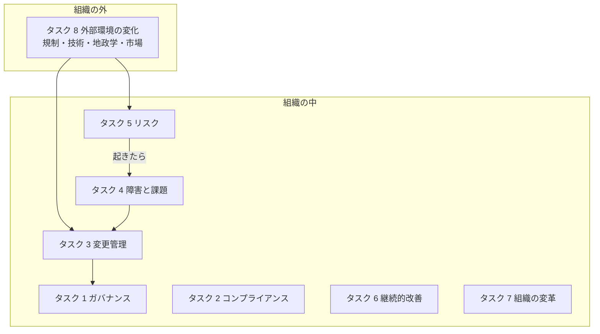
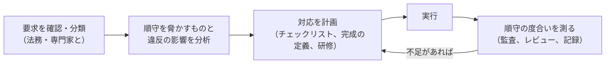
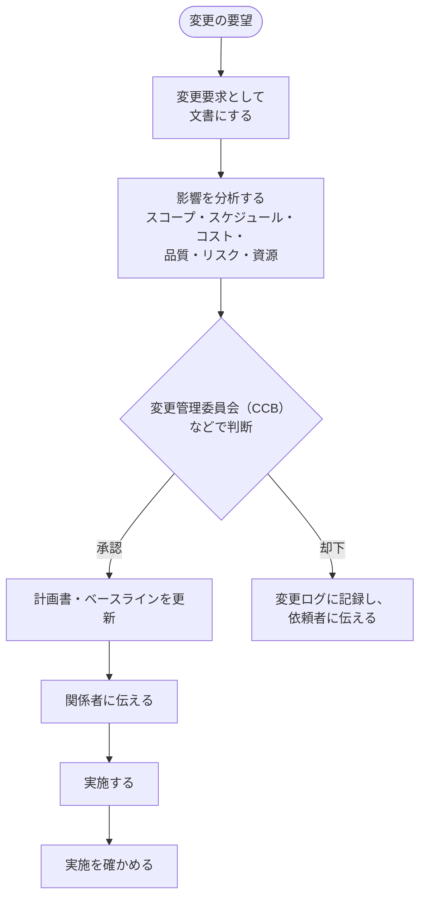
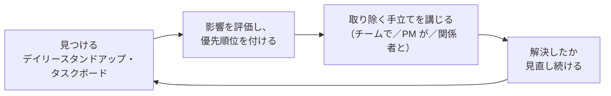
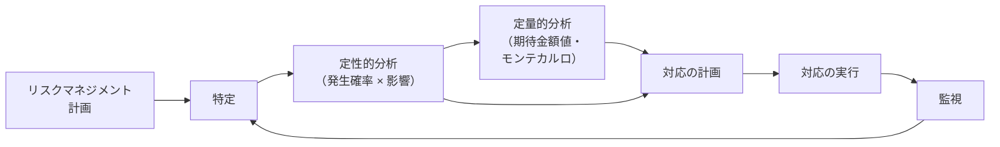
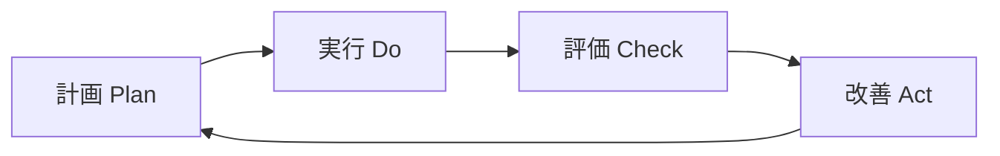
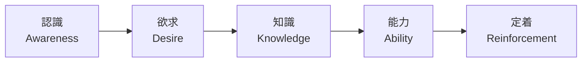
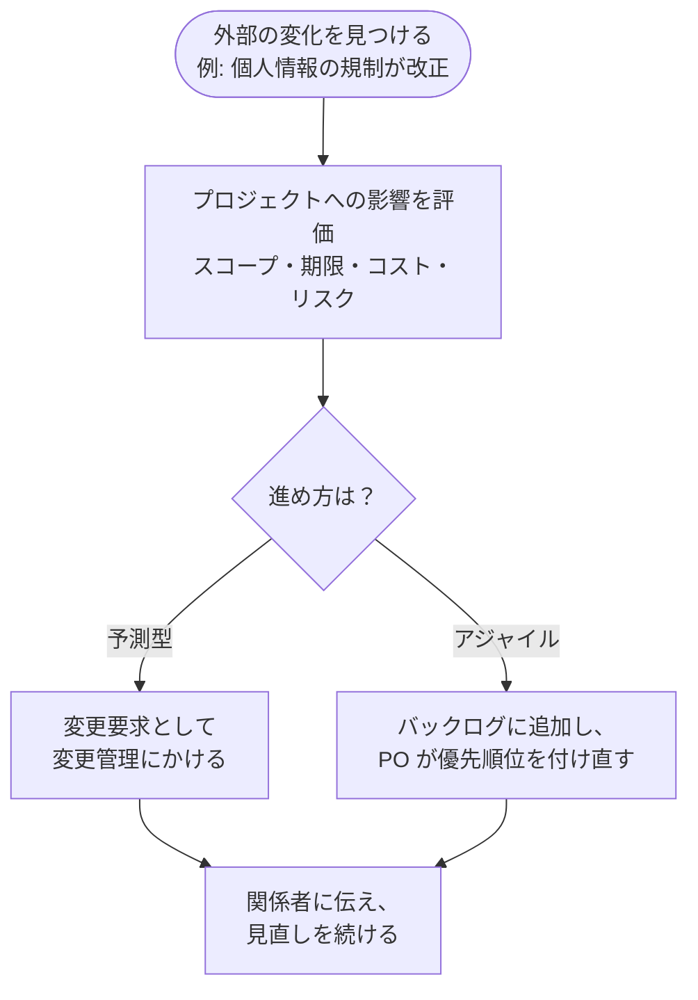

## はじめに：この範囲で学ぶこと

「ビジネス環境（Business Environment）」は配点 26% です。2021 年版の試験では 8% でしたが、**2026 年の新試験で 3 倍以上に増えました**。プロジェクトの外側にある「組織」と「社会」との関わり方が、より重く問われるようになったということです。

なぜ配点が増えたの？

公式の試験内容（ECO 2026）は、プロジェクトの成功を「期限・予算・スコープを守ること」だけでなく、「**費用と労力に見合う価値を届けたか**」で考えるようになりました。価値を届けるには、組織のルールや方針、法令、社会の変化（AI、持続可能性、規制など）に合わせて、プロジェクトを動かし続ける必要があります。それがこの領域です。

---

## 1. ガバナンスを定義し確立する（タスク 1）

### 1-1. ガバナンスとは

ガバナンスは「**誰が・何を・どの基準で決めるか**」の仕組みです。プロジェクトの体制、ルール、手順、報告、倫理、方針を決めます。

| 決めること | 例 |
|---|---|
| 体制 | スポンサー、ステアリングコミッティ（運営委員会）、PMO、変更管理委員会（CCB） |
| ルールと手順 | 承認の流れ、文書のテンプレート、フェーズゲート（次のフェーズに進む判断） |
| 報告 | 誰に、何を、どの頻度で |
| **エスカレーションの経路としきい値** | 「コストが 10% 超えたらスポンサーへ」「2 週間以上の遅れはステアリングコミッティへ」 |
| **成功の指標** | 期限・予算に加え、ベネフィット、利用率、顧客満足など |

### 1-2. 組織のプロセス資産（OPA）と組織体の環境要因（EEF）

| | **組織のプロセス資産（OPA）** | **組織体の環境要因（EEF）** |
|---|---|---|
| 意味 | 組織が持つ**使える資産** | プロジェクトが**従う・影響を受ける**条件 |
| 例 | 手順書、テンプレート、過去の教訓、過去のプロジェクトの記録 | 組織の文化と構造、法令、市場の状況、社内のシステム |
| プロジェクトが変えられるか | **更新できる**（教訓を追加するなど） | 基本的に変えられない |

### 1-3. 組織の構造と PM の権限

| 組織の構造 | PM の権限 | 予算を管理する人 |
|---|---|---|
| **機能型** | ほぼない（調整役） | 機能部門のマネージャー |
| **弱いマトリックス** | 小さい | 機能部門のマネージャー |
| **バランス・マトリックス** | 小〜中 | 両方 |
| **強いマトリックス** | 中〜大 | PM |
| **プロジェクト型** | 大〜全面 | PM |

### 1-4. PMO の種類

| 種類 | 統制の強さ | すること |
|---|---|---|
| **支援型** | 弱い | テンプレート、研修、過去の情報を提供する |
| **コントロール型** | 中くらい | 手法や様式の**順守を求め**、確認する |
| **指揮型** | 強い | プロジェクトを**直接マネジメント**する |

### 1-5. 倫理（PMI 倫理・職務規定）

PMI の倫理規定は 4 つの価値でできています。PMP の問題では、**倫理に反する選択肢は、どんなに効率的でも正解になりません**。

| 価値 | 行動の例 |
|---|---|
| **責任** | 自分の判断の結果に責任を持つ。できないことを引き受けない。過ちを認める |
| **尊重** | 相手の文化や意見を尊重する。直接・礼儀正しく話す |
| **公正** | 利益相反を**開示する**。えこひいきしない。情報を公平に伝える |
| **誠実** | 事実を正確に伝える。嘘をつかない、数字をごまかさない |

具体例：ベンダーからの贈り物

入札中のベンダーから、PM に高価な食事の招待がありました。PM は**会社の方針を確認し、方針に反するなら丁重に断ります**。選定に関わる立場なので、受け取ると公正さが疑われるためです。親族が経営する会社が入札している場合は、**利益相反を開示し、選定から外れます**。

---

## 2. コンプライアンスを計画しマネジメントする（タスク 2）

### 2-1. コンプライアンスの種類

| 分類 | 例 |
|---|---|
| **法令・規制** | 個人情報保護、業界の規制（金融・医療など）、建築基準 |
| **セキュリティ** | 情報セキュリティの基準、アクセス管理、脆弱性への対応 |
| **安全衛生** | 作業の安全、労働時間 |
| **持続可能性・環境** | 環境への影響、排出量の報告、資源の使い方 |
| **社内の方針** | 調達の規程、文書管理、承認の規程 |

### 2-2. 計画から測定まで

| 違反の影響 | 例 |
|---|---|
| 法的・金銭的 | 罰金、訴訟、許認可の取り消し |
| 事業の停止 | 作業の中止命令、製品の出荷停止 |
| 信用 | ブランドの毀損、顧客の離反 |

ひっかけ注意：期限のために規制を後回しにする

「納期に間に合わせるため、規制のチェックは次のリリースに回す」「顧客が急いでいるので、承認前の手順を省く」は**誤り**です。コンプライアンスは**交渉の対象ではありません**。間に合わない場合は、影響を分析し、スコープや期限の変更をステークホルダーと調整します。アジャイルでは、規制の要件を**完成の定義**や受け入れ基準に入れておくのが有効です。

---

## 3. 変更をマネジメントしコントロールする（タスク 3）

### 3-1. 予測型の統合変更管理（頻出）

ポイント：PM が最初にすることは「影響の分析」

ステークホルダーから変更を頼まれたとき、PM が最初にすることは「**影響を分析する**」です。

- いきなり実施する → **誤り**（承認前の実施はスコープクリープ）
- いきなり断る → **誤り**（価値のある変更かもしれない）
- いきなり CCB に出す → 影響の分析がないと判断できない

### 3-2. アジャイルの変更

アジャイルでは、変更は**プロダクトバックログに入れ、プロダクトオーナーが優先順位を付け直す**ことで扱います。ただし、**進行中のスプリントの目標**は基本的に変えません。急ぎでも次のスプリントで取り込むのが原則で、スプリントの目標そのものが意味をなくした場合にだけ、PO がスプリントを中止できます。

| | 予測型 | アジャイル |
|---|---|---|
| 変更の入口 | 変更要求 | バックログへの追加 |
| 判断する人 | CCB・スポンサー（権限による） | プロダクトオーナー |
| 反映のタイミング | 承認後 | 次のスプリントの計画 |

### 3-3. 文書を更新する

承認された変更は、**計画書・ベースライン・要求・リスク登録簿・変更ログ**など、影響を受けるすべての文書に反映します。文書が古いままだと、次の判断を誤ります。

---

## 4. 障害を取り除き課題をマネジメントする（タスク 4）

### 4-1. 言葉の違い

| 言葉 | 意味 | 記録する場所 |
|---|---|---|
| **リスク** | **まだ起きていない**不確かな出来事 | リスク登録簿 |
| **課題** | **すでに起きている**問題 | 課題ログ |
| **障害**（インペディメント・ブロッカー） | チームの作業を**止めている・遅らせている**もの | 課題ログ、タスクボード |

### 4-2. 障害への向き合い方

具体例：別部署の承認待ち

デイリースタンドアップで、開発者が「テスト環境の利用申請の承認が 1 週間止まっている」と報告しました。スクラムマスター（PM）は**スタンドアップの後で**情報システム部門に直接連絡し、承認を急いでもらうよう調整します。チームが自分で解決できない組織の壁を取り除くのは、**サーバントリーダーの大事な役目**です。

### 4-3. リスクが課題になったら

特定していたリスクが実際に起きたら、それは**課題**です。**リスク対応計画（コンティンジェンシー計画）を実行**し、課題ログに記録します。特定していなかった問題が起きた場合は、その場で対処策（**ワークアラウンド**）を講じ、あとでリスクの特定が漏れていた理由を振り返ります。

---

## 5. リスクを計画しマネジメントする（タスク 5）

### 5-1. リスクの基本

- リスクは**脅威（マイナス）と好機（プラス）**の両方がある
- リスクマネジメントは**プロジェクトの最初から最後まで繰り返す**
- **リスク選好**（どこまで受け入れるか）と**しきい値**は組織とステークホルダーが決める

| 段階 | 主な手法 |
|---|---|
| **特定** | ブレーンストーミング、チェックリスト、前提条件の分析、SWOT、**プロンプトリスト（PESTLE など）**、専門家の判断 |
| **定性的分析** | **発生確率・影響度マトリックス**で優先順位を付ける |
| **定量的分析** | **期待金額値（EMV）**、ディシジョンツリー、モンテカルロ・シミュレーション、感度分析（トルネード図） |

### 5-2. 期待金額値（計算問題）

**EMV ＝ 発生確率 × 影響額**（脅威はマイナス、好機はプラス）

計算例

- 脅威：部品の納期遅れ。確率 30%、影響 −200 万円 → EMV ＝ **−60 万円**
- 好機：まとめ買いの割引。確率 20%、影響 ＋100 万円 → EMV ＝ **＋20 万円**
- 合計 ＝ −60 ＋ 20 ＝ **−40 万円**（この 40 万円をコンティンジェンシー予備の目安にできる）

ディシジョンツリーでは、選択肢ごとに「費用 ＋ EMV」を計算し、**期待値が最も良い**選択肢を選びます。

### 5-3. リスクへの対応（頻出）

| 脅威への対応 | 内容 | 好機への対応 | 内容 |
|---|---|---|---|
| **回避** | 原因を取り除き、リスクをなくす（計画の変更） | **活用** | 好機を**確実に**起こす |
| **転嫁** | 他者に移す（保険、契約、保証） | **共有** | 好機を生かせる第三者と組む |
| **軽減** | 確率か影響を下げる（試作、追加テスト） | **強化** | 確率か影響を上げる |
| **受容** | 何もしない（受動的）か、予備費を用意する（能動的） | **受容** | 起きたら生かす |
| **エスカレーション** | PM の権限を超えるリスクを、上位の組織に渡す | **エスカレーション** | 同じ |

| 用語 | 意味 |
|---|---|
| **リスクオーナー** | そのリスクの監視と対応に責任を持つ人 |
| **トリガー** | リスクが起きそうな兆し。対応を始める合図 |
| **コンティンジェンシー計画** | リスクが起きたときに実行する計画 |
| **代替計画（フォールバック計画）** | コンティンジェンシー計画が効かなかったときの計画 |
| **残存リスク** | 対応した後も残るリスク |
| **二次リスク** | 対応したことで**新しく生まれる**リスク |

### 5-4. アジャイルのリスク対応

- **短い反復**で早くフィードバックを得ることが、最大のリスク対応
- リスク対応の作業を**バックログに入れて優先順位を付ける**（リスク調整済みバックログ）
- 技術的に分からないことは**スパイク**（調査のための短い作業）で確かめる
- デイリースタンドアップと振り返りで、リスクを**頻繁に見直す**

### 5-5. IT セキュリティと持続可能性のリスク

ECO では、IT セキュリティの弱さ（例: アクセス管理の不備、脆弱性）や、**持続可能性のリスク**（環境規制の強化、エネルギー価格の変動）もリスク登録簿で管理することが例として挙げられています。セキュリティの専門家を早めに巻き込み、セキュリティの要件を受け入れ基準や完成の定義に入れておきます。

---

## 6. 継続的に改善する（タスク 6）

| 道具 | 内容 |
|---|---|
| **教訓登録簿** | プロジェクト中の学びを**その都度**記録する |
| **振り返り（レトロスペクティブ）** | スプリントごとに「続けること・やめること・始めること」を話し合い、**次のスプリントで試す改善を 1〜2 個**決める |
| **組織のプロセス資産（OPA）の更新** | 学びを組織の手順書・テンプレート・知識ベースに反映し、**次のプロジェクトに渡す** |

ポイント：教訓は「使う」まで

教訓は記録して終わりではありません。**計画を立てるときに過去の教訓を参照する**こと、**改善の結果を確かめる**ことまでが継続的改善です。問題で「新しいプロジェクトを始める。最初に何をする？」と聞かれたら、**過去の教訓や記録（OPA）の確認**が正解になることがよくあります。

---

## 7. 組織の変革を支援する（タスク 7）

### 7-1. 組織の文化を見る

新しいシステムや仕組みを導入するプロジェクトは、人の働き方を変えます。**組織の文化**（意思決定の仕方、変化への慣れ、上下関係の強さ）によって、変化の受け入れやすさは大きく違います。

### 7-2. 変化を支える考え方

| モデル | 内容 |
|---|---|
| **ADKAR** | 個人が変わる 5 段階：**認識**（なぜ変わる必要があるか）→ **欲求**（変わりたい）→ **知識**（どう変わるか）→ **能力**（実際にできる）→ **定着**（続ける） |
| **コッターの 8 段階** | 危機感を高める → 推進チームを作る → ビジョンを作る → 伝える → 障害を取り除く → 短期的な成果を出す → 成果を生かしてさらに進める → 文化に定着させる |

具体例：新しいシステムが使われない

新しい受発注システムを導入しましたが、現場はまだ Excel を使っています。研修（知識）はすでに行いました。PM は利用者に話を聞き、「なぜ変える必要があるのか」が伝わっていない（**認識**の段階でつまずいている）ことに気づきました。そこで、部門長から変える理由を説明してもらい、早く慣れた人の成功例を共有しました。**研修を追加するだけでは解決しない**例です。

### 7-3. 組織の変化がプロジェクトに与える影響

組織再編、経営方針の変更、スポンサーの交代などは、プロジェクトの目的や優先順位を変えます。PM は**影響を評価**し、ビジネスケース・ステークホルダー登録簿・計画を見直して、必要なら変更管理にかけます。

ひっかけ注意：スポンサーが交代した

スポンサーが交代したら、PM は**新しいスポンサーと早めに会い**、プロジェクトの目的・状況・期待を確かめ合います。「前のスポンサーと合意済みだから」とそのまま進めるのは誤りです。

---

## 8. 外部のビジネス環境の変化を評価する（タスク 8）

### 8-1. 何を見るか（PESTLE）

| 視点 | 例 |
|---|---|
| **政治**（Political） | 政権の方針、補助金、地政学的な緊張、貿易の制限 |
| **経済**（Economic） | 為替、物価、金利、景気 |
| **社会**（Social） | 人口、働き方、価値観の変化 |
| **技術**（Technological） | **AI**、新しいプラットフォーム、技術の陳腐化 |
| **法律**（Legal） | 新しい法令、規制の改正 |
| **環境**（Environmental） | 気候変動、環境規制、持続可能性の要請 |

### 8-2. 影響を評価して、スコープやバックログに反映する

なぜ「続けて見る」の？

外部環境は、プロジェクトの最初に一度調べただけでは足りません。規制の改正や競合の新製品は、プロジェクトの途中で起こります。だから ECO では「**継続的に見直す**」ことが明記されています。リスクの特定と同じく、定期的に確認する場（例: 月 1 回のリスクレビュー）を決めておきます。

### 8-3. AI を使うときの注意

ECO 2026 は、AI の広がりを試験に取り入れるべき変化として挙げています。プロジェクトで AI（議事録の要約、リスクの洗い出し、見積もりの補助など）を使うときは、次の点を押さえます。

| 注意点 | 内容 |
|---|---|
| **確かめる** | AI の出力は**人が確認してから**使う。最終的な判断と責任は人にある |
| **情報を守る** | 機密情報や個人情報を、許可されていない AI サービスに入力しない。組織の方針に従う |
| **透明にする** | AI を使ったことを、必要に応じて関係者に伝える |
| **偏りに注意する** | 学習データの偏りが、判断の偏りにつながることがある |

やってみよう（25 分・紙とペンで）

身近なプロジェクト（または「社内の業務システムの入れ替え」という想定）で、次を書き出してみましょう。

1. エスカレーションのしきい値を 3 つ決める（コスト・スケジュール・品質）
2. 守るべきコンプライアンスの要件を、分類ごとに 1 つずつ挙げる
3. リスクを 5 つ挙げ、それぞれ確率と影響額を仮に置いて EMV を計算し、対応（回避・転嫁・軽減・受容）を決める
4. PESTLE の 6 つの視点で、プロジェクトに影響しそうな外部の変化を 1 つずつ挙げる
5. 新しい仕組みを定着させるために、ADKAR の各段階で何をするか 1 行ずつ書く

---

## 9. まとめ

| テーマ | 覚えること |
|---|---|
| 配点 | 8% → 26%。価値を届けるための組織・社会との関わり |
| ガバナンス | 体制・ルール・報告・倫理。エスカレーションのしきい値と成功の指標を決める |
| OPA と EEF | OPA は使える資産で更新できる。EEF は従う条件 |
| 組織の構造 | 機能型は PM の権限が小さく、プロジェクト型は大きい |
| PMO | 支援型・コントロール型・指揮型 |
| 倫理 | 責任・尊重・公正・誠実。利益相反は開示する |
| コンプライアンス | 確認 → 分類 → 脅威と影響の分析 → 対応 → 測定。期限のために省かない |
| 変更管理 | まず影響の分析。承認後にベースライン更新。アジャイルはバックログと PO |
| 課題と障害 | リスクは未発生、課題は発生済み。障害を取り除くのはサーバントリーダーの役目 |
| リスク | 特定 → 定性 → 定量 → 対応 → 監視を繰り返す。EMV ＝ 確率 × 影響 |
| リスク対応 | 脅威は回避・転嫁・軽減・受容、好機は活用・共有・強化・受容。両方にエスカレーション |
| 継続的改善 | 教訓はその都度。振り返りで改善を決める。OPA を更新する |
| 組織の変革 | 文化を見る。ADKAR・コッター。スポンサーの交代は早めに会う |
| 外部環境 | PESTLE で継続的に見る。影響を評価し、変更管理かバックログへ |
| AI | 出力を確かめ、情報を守り、透明に |

## 試験直前チェック

- [ ] ビジネス環境の配点が増えた理由を説明できる
- [ ] エスカレーションの経路としきい値を決める理由を言える
- [ ] OPA と EEF の違いと例を言える
- [ ] 組織の構造ごとの PM の権限を言える
- [ ] PMO の 3 つの種類を言える
- [ ] PMI 倫理規定の 4 つの価値と、利益相反への対応を言える
- [ ] コンプライアンスの分類と、違反の影響を言える
- [ ] 変更を頼まれたときに PM が最初にすることを言える
- [ ] 統合変更管理の流れを順番に言える
- [ ] アジャイルで変更をどう扱うか、スプリント中の変更の原則を言える
- [ ] リスク・課題・障害の違いを言える
- [ ] EMV を計算できる
- [ ] 脅威と好機への対応をそれぞれ言える
- [ ] 残存リスクと二次リスクの違いを言える
- [ ] 振り返りで決めることを言える
- [ ] ADKAR の 5 段階を言える
- [ ] PESTLE の 6 つの視点を言える
- [ ] AI を使うときの注意点を 3 つ言える
