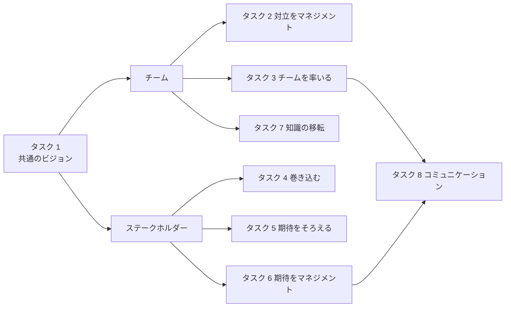
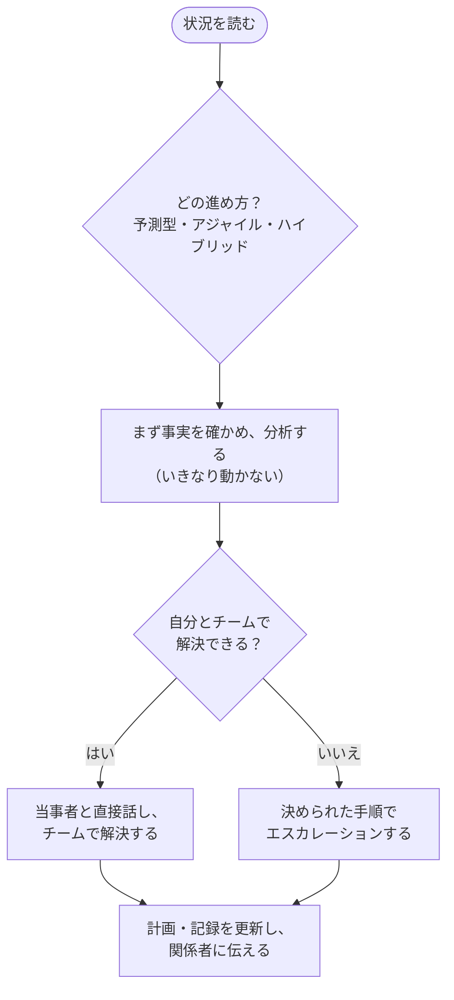
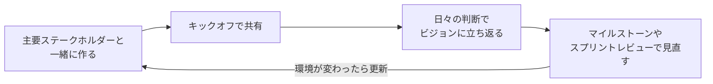
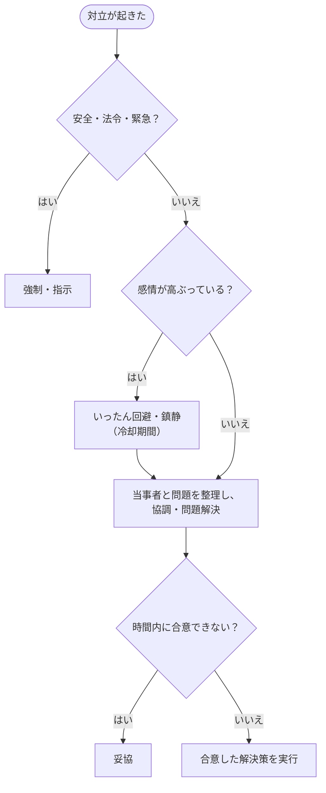
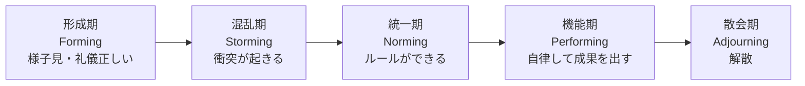
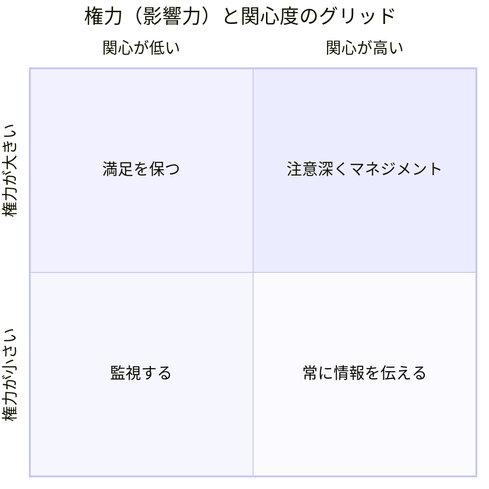
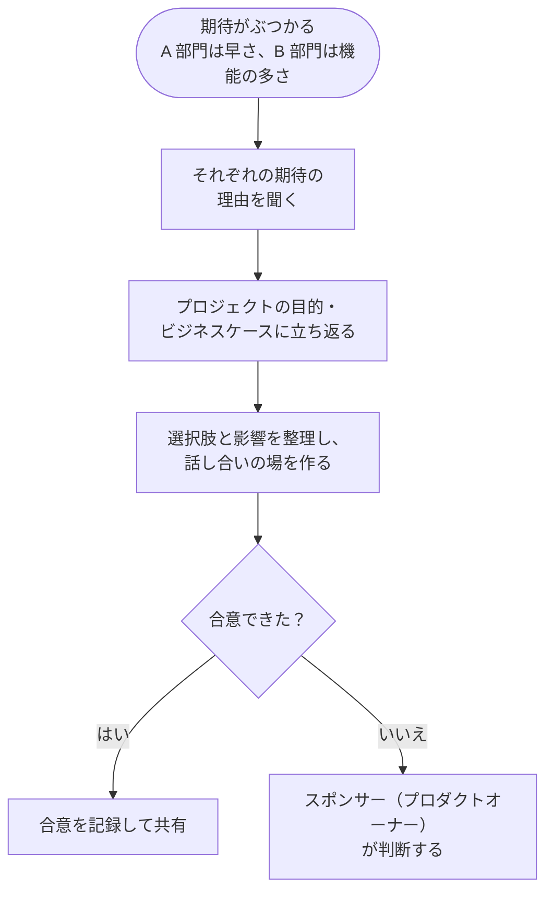
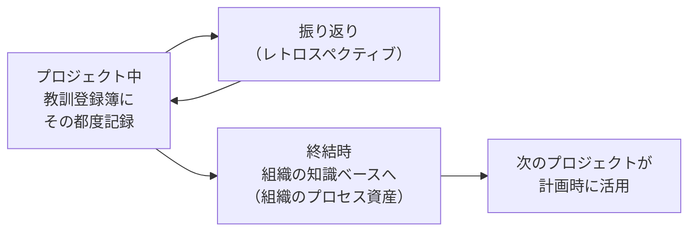

## はじめに：この範囲で学ぶこと

「人（People）」は配点 33% です。プロジェクトを動かすのは計画書ではなく**人**です。この領域では、チームとステークホルダーをどう導くかが問われます。公式の試験内容（ECO 2026）では 8 つのタスクがあります。

このレッスンの読み方

PMP の問題は、ほとんどが「**あなたはプロジェクトマネージャー（PM）です。次に何をしますか？**」という状況問題です。知識そのものより、**PMI が考える「良い PM の動き方」**を選べるかが問われます。最初にその考え方（マインドセット）を押さえてから、各タスクに進みましょう。

- **なぜ？** … その考え方の理由
- **具体例** … 架空のプロジェクトでの状況
- **ひっかけ注意** … 試験でよく間違える選択肢のパターン
- **やってみよう** … 自分の仕事に当てはめて書き出す練習

### PMP 試験の考え方（全レッスン共通）

| 考え方 | 試験での選び方 |
|---|---|
| **まず分析** | 「すぐに変更する」「すぐ上に報告する」より、**状況の確認・影響の分析**が先 |
| **当事者と直接話す** | 問題のある人とは**直接・個別に**話す。メールで全員に送る、上司に言いつける、は後回し |
| **チームに任せる** | アジャイルではチームが**自分たちでやり方を決める**。PM は答えを押し付けず、支援する（サーバントリーダー） |
| **価値と目的が最優先** | 「計画どおり」より「**ビジネス価値**が出るか」。価値がなくなったら、続けるべきかをスポンサーに提案する |
| **決められた手順を使う** | 変更は**変更管理**、契約の問題は**契約の条項**、人事の問題は**組織のルール**に沿う |
| **倫理を守る** | 嘘・隠ぺい・規則違反・利益相反は**どんな事情でも選ばない** |

ひっかけ注意：「上に報告する」は最初の一手ではない

「スポンサーにエスカレーションする」「機能部門のマネージャーに報告する」は、多くの問題で**誤りの選択肢**です。PM の権限で解決できることは、まず PM とチームで解決します。エスカレーションが正解になるのは、**PM の権限を超える**（予算の上限、契約、人事、方針）ときや、決められたしきい値を超えたときです。

---

## 1. 共通のビジョンを築く（タスク 1）

### 1-1. ビジョンとは

ビジョンは「**このプロジェクトは何のためにあり、終わったときに何が良くなっているか**」を短く言い表したものです。チームが迷ったときに立ち返る「北極星」の役割をします。

| ビジョンを形にする道具 | 内容 |
|---|---|
| **プロジェクト憲章** | プロジェクトを正式に認め、PM に権限を与える文書。目的・高いレベルの要求・成功基準・主要なリスクを書く |
| **プロダクトビジョン** | 誰の・どんな課題を・どう解決するかを 1〜2 文で表す。アジャイルでよく使う |
| **エレベーターピッチ／プロダクトボックス** | 短い説明や「製品の箱」をチームで作り、価値をひと目で伝える |
| **チームチャーター** | チームの価値観・合意事項・グラウンドルールをまとめたもの（次の節で詳しく） |

### 1-2. 共有し、浸透させ、最新に保つ

なぜ？ PM が一人で決めて通知してはいけない理由

ビジョンは「知っている」だけでは機能しません。**自分たちで作ったもの**だと思えて初めて、日々の判断の基準になります。だから主要なステークホルダーとチームを巻き込み、**一緒に作る**のが基本です。PM が作って配るだけ、という選択肢は誤りになりやすいです。

### 1-3. ビジョンの誤解をほどく

ビジョンの受け取り方が人によって違うと、優先順位や品質の考え方がずれます。症状に対処する前に、**なぜ誤解が起きたか**（根本原因）を突き止めます。

具体例

社内の問い合わせ窓口を新しくするプロジェクト。営業部は「問い合わせを早く片付けること」、品質保証部は「回答の正確さ」が目的だと思っています。会議のたびに議論がかみ合いません。

PM は両者に話を聞き、**ビジョンに「誰の・何を良くするか」が書かれていない**ことが原因だと分かりました。そこでスポンサーと主要ステークホルダーを集め、「社員が 1 回の問い合わせで正しい答えを得られる」というビジョンに言い直し、成功の指標（初回解決率と回答の正確さ）も合意しました。

---

## 2. 対立をマネジメントする（タスク 2）

### 2-1. 対立は「悪」ではない

対立は、意見の違いがある健全なチームでは**自然に起きる**ものです。大切なのは、**早めに、当事者同士で、問題そのもの**に向き合うことです。

| よくある対立の原因 | 例 |
|---|---|
| スケジュールと優先順位 | どの作業を先にやるか |
| 資源（人・予算・機材） | 同じ人を 2 つのプロジェクトが取り合う |
| 技術的な意見 | 設計の方針が分かれる |
| 手順・役割 | 誰が決めるのか、どこまでやるのか |
| 人柄・価値観 | 進め方や話し方の違い |

### 2-2. 対立への 5 つの向き合い方（頻出）

| 方法 | 内容 | 向いている場面 |
|---|---|---|
| **協調・問題解決**（Collaborate / Problem Solve） | 複数の視点を取り入れ、**根本原因を解決**して全員が納得する | 時間があり、関係を長く保ちたい。**多くの問題で最善** |
| **妥協・和解**（Compromise / Reconcile） | お互いに少しずつ譲る。**全員が少し不満**が残る | 時間が限られ、両者の力が同じくらい |
| **鎮静・適応**（Smooth / Accommodate） | 合意できる点を強調し、相違点を小さく扱う | 感情を落ち着かせたい。関係を守るのが優先 |
| **強制・指示**（Force / Direct） | 権限で一方の意見に決める | 緊急時、安全や法令に関わるとき |
| **撤退・回避**（Withdraw / Avoid） | いったん引く・先送りする | 熱くなりすぎて冷却期間が必要。問題が自然に解消しそう |

ポイント：誰が解決するか

対立は**できるだけ当事者のレベルで**解決します。PM はまず当事者同士の話し合いを促し、必要なら場を作って進行役（ファシリテーター）を務めます。人前で叱る、片方だけの話で決める、いきなり上司に任せる、はどれも避けます。

### 2-3. アジャイルでの対立の深さ（スピード・リースの 5 段階）

アジャイルの問題では、対立の深さに応じて関わり方を変える考え方が出ます。

| 段階 | 様子 | PM・コーチの関わり方 |
|---|---|---|
| 1 問題を解決しよう | 事実ベースで話し合っている | 見守る。チームに任せる |
| 2 意見の相違 | 自分を守る発言が出る | 安全に話せる場を作る |
| 3 競い合い | 勝ち負けになり、味方を集める | 事実と共通の目的に立ち返らせる |
| 4 正義の戦い | 相手を変えるより「やっつける」 | 間に入り、緊張を下げる |
| 5 全面戦争 | 相手を排除しようとする | 当事者を分ける。組織として介入する |

### 2-4. グラウンドルールを作って守る

グラウンドルールは「会議は時間どおりに始める」「批判は人ではなく案に向ける」など、**チームが自分たちで決めた約束**です。**チームチャーター**にまとめておきます。

具体例：ルール違反への対応

デイリースタンドアップに毎回遅れてくるメンバーがいます。PM がまずすることは、**本人と個別に話し、理由を聞く**ことです（時差のある拠点からの参加で時間が合わない、など）。必要ならチームで時間を見直します。繰り返される場合は、チームチャーターに立ち返ってチームで話し合い、それでも改善しなければ、組織のルールに沿って機能部門のマネージャーと相談します。

---

## 3. プロジェクトチームを率いる（タスク 3）

### 3-1. サーバントリーダーシップ

アジャイルの基本となるリーダーシップです。PM は命令する人ではなく、**チームが成果を出せるように支える人**です。

| サーバントリーダーがすること | 例 |
|---|---|
| **障害を取り除く** | 他部署の承認待ち、環境が使えない、などを片付ける |
| **チームを守る** | 割り込みの作業や、横からの指示からチームを守る |
| **権限を委ねる** | 「どう作るか」はチームが決める |
| **成長を支える** | コーチング、学びの機会を作る |
| **チームの声を代弁する** | 経営層やステークホルダーにチームの状況・必要なことを伝える |

### 3-2. チームの成長段階とリーダーシップの合わせ方

| 段階（タックマン・モデル） | 合うリーダーシップ |
|---|---|
| 形成期 | **指示型**：目的・役割・ルールをはっきり示す |
| 混乱期 | **コーチ型**：対立を整理し、話し合いを促す |
| 統一期 | **支援型**：チームの決定を支える |
| 機能期 | **委任型**：任せて見守る。障害の除去に集中する |

なぜ？ 状況でスタイルを変える

同じチームでも、メンバーの経験やプロジェクトの段階によって必要な支援は違います。新しく入った人には具体的な指示が、経験豊富なチームには任せることが効きます。これを**状況対応型リーダーシップ**と呼びます。「いつも同じスタイル」より「**状況に合わせる**」が正解になりやすいです。

### 3-3. 役割と責任をはっきりさせる

**RACI チャート**で、作業ごとに誰が何をするかを決めます。

| 作業 | PM | 開発リーダー | 業務担当 | スポンサー |
|---|---|---|---|---|
| 要件の承認 | C | C | R | **A** |
| 設計 | I | **A** | C | — |
| テスト計画 | **A** | R | R | I |

- **R**（Responsible）実行する人
- **A**（Accountable）最終責任者。**1 つの作業に 1 人だけ**
- **C**（Consulted）相談を受ける人
- **I**（Informed）結果を知らされる人

アジャイル（スクラム）の役割も押さえておきます。

| 役割 | 責任 |
|---|---|
| **プロダクトオーナー** | **何を作るか**と優先順位（プロダクトバックログ）を決め、価値を最大化する |
| **スクラムマスター** | スクラムが機能するよう支える。障害の除去、チームのコーチ |
| **開発者（チーム）** | **どう作るか**を決め、完成の定義を満たす成果物を作る |

### 3-4. 多様なチームを生かす

- **心理的安全性**：失敗や反対意見を言っても責められない雰囲気を作る
- **感情的知性（EQ）**：自分と相手の感情を理解し、関係を築く
- **動機づけ**：お金や罰より、**自律性・成長・目的**が長続きするやる気を生む
- **バーチャルチーム**：時差・文化・言語の違いに配慮し、**ワーキングアグリーメント**（連絡手段、返信の目安、会議の時間帯）を決める
- **スキルの不足**：研修・ペア作業・クロストレーニングで補う。専門＋幅広い知識を持つ **T 字型人材**を育てる

ひっかけ注意：アジャイルのチームに作業を割り振る

アジャイルのチームで「PM がタスクを割り当てる」選択肢は誤りです。チームは**自己組織化**しており、メンバーが自分で作業を選びます。PM（スクラムマスター）は、チームが決められるように支えます。

---

## 4. ステークホルダーを巻き込む（タスク 4）

### 4-1. 特定する：早く、何度も

ステークホルダーは、プロジェクトに影響を与える人・受ける人すべてです。**プロジェクトの最初に**洗い出し、**途中でも繰り返し**見直します。結果は**ステークホルダー登録簿**にまとめます。

### 4-2. 分析する

| 分析の道具 | 内容 |
|---|---|
| **権力・関心度グリッド** | 上の図。関わり方の強さを決める |
| **突出モデル** | 権力・正当性・緊急性の 3 つで重要度を見る |
| **エンゲージメント評価マトリックス** | 「知らない・抵抗・中立・支援・主導」の 5 段階で、**今（C）**と**望ましい状態（D）**を比べ、差を埋める計画を立てる |

### 4-3. 計画を実行し、信頼を築く

具体例：抵抗しているステークホルダー

新しい経費精算システムの導入に、経理部長が強く反対しています。PM は会議で説得しようとするのではなく、**まず個別に会って懸念を聞きました**。すると「月末の締め処理が遅れる」ことを心配していると分かりました。PM は締め処理の担当者をテストに参加してもらうよう提案し、懸念に応える計画に変えました。経理部長は「抵抗」から「中立」、やがて「支援」に変わりました。

ポイント：抵抗する人ほど早く巻き込む

反対している人を避けると、終盤で大きな反対になって返ってきます。**早めに会い、懸念を聞き、計画に反映する**のが基本です。

---

## 5. ステークホルダーの期待をそろえる（タスク 5）

### 5-1. 分類して期待をつかむ

| 分類の切り口 | 例 |
|---|---|
| 社内か社外か | 社内の業務部門 ／ 顧客・規制当局・ベンダー |
| 関係の向き | 上（経営・スポンサー）・下（チーム）・横（他部署）・外（顧客など） |
| 期待の種類 | 目に見える期待（納期・機能）と、**言葉にされない期待**（「当然こうなるはず」） |

言葉にされない期待は、後から「こんなはずではなかった」になる原因です。**インタビューやワークショップで引き出し、書いて合意**しておきます。

### 5-2. 期待がぶつかったら

話し合いで合意を作る手法も覚えておきましょう。

| 手法 | やり方 |
|---|---|
| **フィスト・オブ・ファイブ** | 指の数（0〜5）で賛成の度合いを示す。2 本以下の人の懸念を聞く |
| **ローマ式投票** | 親指を上（賛成）・横（どちらでもない）・下（反対）で示す |
| **ドット投票** | シールを配り、良いと思う案に貼る。優先順位付けに使う |

### 5-3. メンタリングの機会を作る

ECO では「メンタリングの機会を作って生かす」ことも求められます。経験の浅いメンバーとベテランを組ませる、アジャイルに慣れていないステークホルダーに考え方を説明する、などです。**期待のずれは、知識の差から生まれることが多い**ためです。

---

## 6. ステークホルダーの期待をマネジメントする（タスク 6）

社内外の「顧客」の期待をつかみ、成果を合わせ続け、満足度を確かめます。

| すること | 方法の例 |
|---|---|
| 期待を確かめる | 受け入れ基準を合意する、デモで早めに見てもらう |
| 成果を合わせ続ける | スプリントレビューでフィードバックをもらい、バックログに反映する |
| 満足度を監視する | アンケート、定例会議での確認、苦情や問い合わせの件数 |
| ずれたら対応する | 原因を分析し、必要なら**変更要求**として正式に扱う |

ひっかけ注意：ゴールドプレーティング

頼まれていない機能をチームが「良かれと思って」追加することを**ゴールドプレーティング**と呼びます。顧客の満足につながるように見えますが、**コスト・リスク・品質のばらつき**を生むため、PMP では**避けるべき行動**です。期待を超えるのではなく、**合意した期待にきちんと応える**のが基本です。

---

## 7. 知識の移転を確実にする（タスク 7）

### 7-1. 2 種類の知識

| 種類 | 例 | 移し方 |
|---|---|---|
| **形式知**（書ける知識） | 手順書、設計書、教訓の記録 | 文書・Wiki・リポジトリ |
| **暗黙知**（書きにくい知識） | 経験のコツ、判断の勘所 | ペア作業、ジョブシャドウイング、勉強会、ストーリーテリング、実践コミュニティ |

### 7-2. いつ、何を残すか

なぜ？ 「最後にまとめて」では遅い

教訓をプロジェクトの最後にだけ集めると、細かいことは忘れられ、**途中で生かす**こともできません。だから教訓は**プロジェクト中ずっと**記録し、振り返りで改善につなげます。また、特定の人しか知らないこと（**属人化**）は、その人が抜けたときの大きなリスクです。

---

## 8. コミュニケーションを計画・マネジメントする（タスク 8）

### 8-1. コミュニケーション戦略を決める

**コミュニケーションマネジメント計画**に「**誰に・何を・いつ・どの方法で・誰が**」伝えるかを書きます。

| 伝え方 | 内容 | 例 |
|---|---|---|
| **双方向**（インタラクティブ） | その場でやりとりする。誤解を最も減らせる | 会議、電話、ビデオ会議 |
| **プッシュ型** | 送り手から特定の相手に送る | メール、レポートの送付 |
| **プル型** | 受け手が必要なときに取りにいく | Wiki、共有フォルダ、ダッシュボード |

### 8-2. コミュニケーションチャネルの数（計算問題）

人数が増えると、やりとりの経路は急に増えます。

**チャネル数 ＝ n × (n − 1) ÷ 2**（n は人数）

計算例

チームが 6 人から 9 人に増えました。チャネルはいくつ増えましたか？

- 6 人：6 × 5 ÷ 2 ＝ **15**
- 9 人：9 × 8 ÷ 2 ＝ **36**
- 増えた数：36 − 15 ＝ **21**

PM 自身を人数に含めるかは問題文をよく読みます（「PM を含めて 9 人」など）。

### 8-3. 透明性とフィードバック

- **情報ラジエーター**：タスクボード、バーンダウンチャートなどを**誰でも見える場所**に掲示する（アジャイル）
- **デイリースタンドアップ**：15 分以内で、昨日やったこと・今日やること・障害を共有する。**問題の解決は会議の後で**
- **フィードバックの仕組み**：伝えたら**理解されたかを確かめる**。送りっぱなしにしない
- **同じ場所で働く（コロケーション）**：自然に情報が耳に入る（浸透型コミュニケーション）。難しければビデオ会議やチャットで補う

### 8-4. 報告とガバナンス

| 相手 | 求められる報告 |
|---|---|
| **スポンサー・経営層** | 要点だけ。進捗の全体像、**判断が必要なこと**、主要なリスク |
| **ステアリングコミッティ** | ガバナンスの基準（しきい値）を超えた差異、承認が必要な変更 |
| **チーム** | 詳しい作業状況、障害、次の作業 |

ポイント：報告は「相手に合わせて」

同じ情報でも、相手によって詳しさと形を変えます。経営層に作業の細部を送る、チームに要約しか渡さない、はどちらも不適切です。**報告の要件（誰が・何のために・どの頻度で必要か）**をまず確かめます。

やってみよう（25 分・紙とペンで）

今の仕事か、最近のプロジェクトを題材にしてみましょう。

1. ステークホルダーを 8 人（または 8 グループ）書き出す
2. 権力・関心度グリッドの 4 つの枠に分ける
3. そのうち 2 人について、エンゲージメントの「今（C）」と「望ましい状態（D）」を書き、差を埋める行動を 1 つずつ考える
4. 「誰に・何を・いつ・どの方法で」を表にして、簡単なコミュニケーション計画を作る
5. チームのグラウンドルールを 3 つ考える

---

## 9. まとめ

| テーマ | 覚えること |
|---|---|
| 試験の考え方 | まず分析 → 当事者と直接話す → チームで解決 → 権限を超えたら手順どおりエスカレーション |
| ビジョン | 主要ステークホルダーと一緒に作り、見直し続ける。誤解は根本原因から |
| 対立 | 自然なもの。当事者レベルで、多くは協調・問題解決が最善。緊急・安全は強制 |
| グラウンドルール | チームが決め、チームチャーターに。違反はまず本人と個別に |
| リーダーシップ | サーバントリーダー。チームの段階に合わせて指示型 → 委任型 |
| 役割 | RACI（A は 1 人）。PO は何を、チームはどう作るか |
| ステークホルダー | 早く・繰り返し特定。グリッドと C/D で分析。抵抗する人ほど早く巻き込む |
| 期待 | 言葉にされない期待を引き出す。ぶつかったら目的に立ち返り、決めるのはスポンサー・PO |
| ゴールドプレーティング | 頼まれていない追加はしない |
| 知識の移転 | 形式知と暗黙知。教訓はプロジェクト中ずっと |
| コミュニケーション | 誰に・何を・いつ・どう。チャネル数 n(n−1)/2。相手に合わせて報告 |

## 試験直前チェック

- [ ] 「すぐにエスカレーションする」が誤りになる理由と、正しくなる場面を言える
- [ ] ビジョンを PM 一人で決めない理由を説明できる
- [ ] 対立への 5 つの向き合い方と、それぞれが向いている場面を言える
- [ ] グラウンドルール違反への最初の対応を言える
- [ ] タックマン・モデルの 5 段階と、合うリーダーシップを言える
- [ ] サーバントリーダーがすることを 3 つ言える
- [ ] RACI の 4 つと「A は 1 人」を言える
- [ ] プロダクトオーナー・スクラムマスター・開発者の責任の違いを言える
- [ ] 権力・関心度グリッドの 4 つの関わり方を言える
- [ ] エンゲージメント評価マトリックスの C と D の意味を言える
- [ ] ゴールドプレーティングを避ける理由を言える
- [ ] 形式知と暗黙知の移し方の違いを言える
- [ ] コミュニケーションチャネルの数を計算できる
- [ ] 双方向・プッシュ型・プル型の違いを言える
