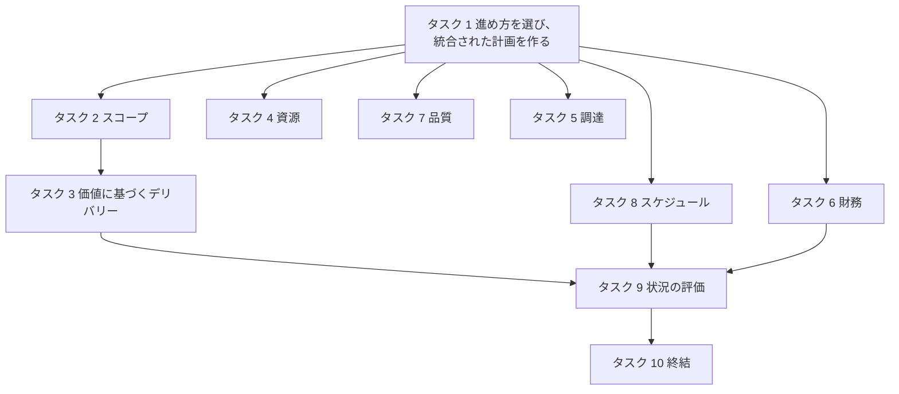
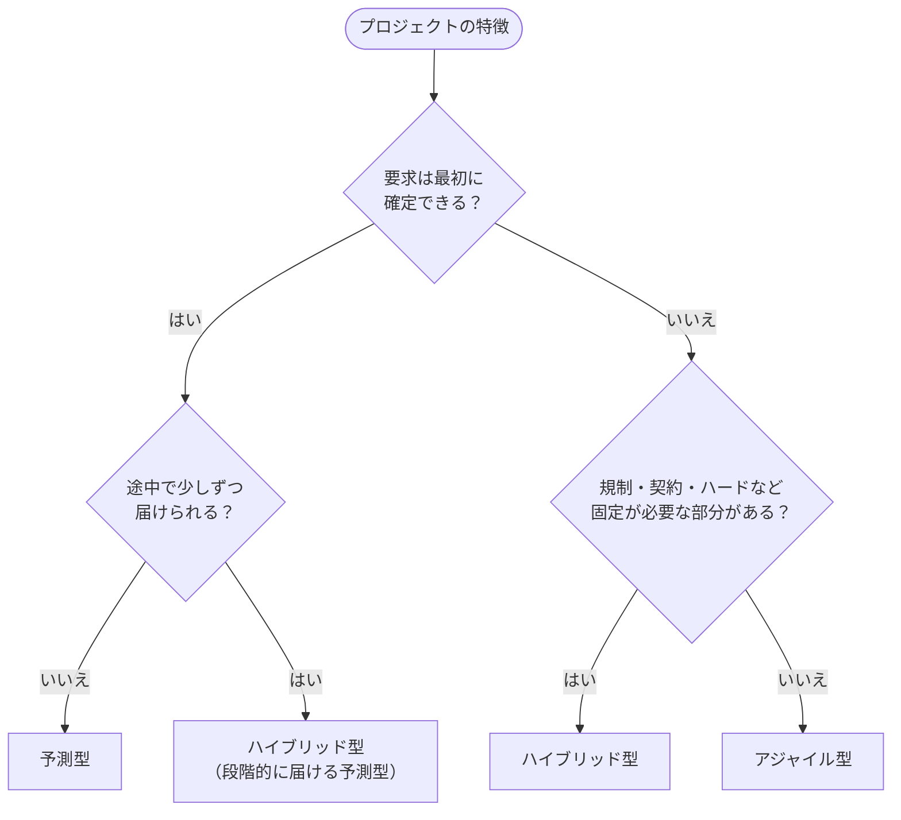
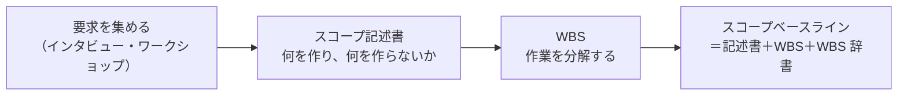
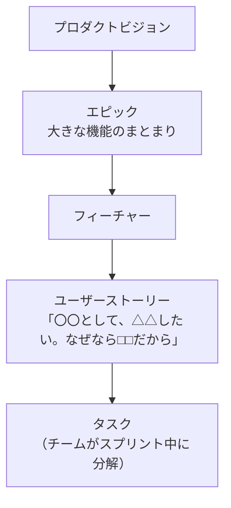
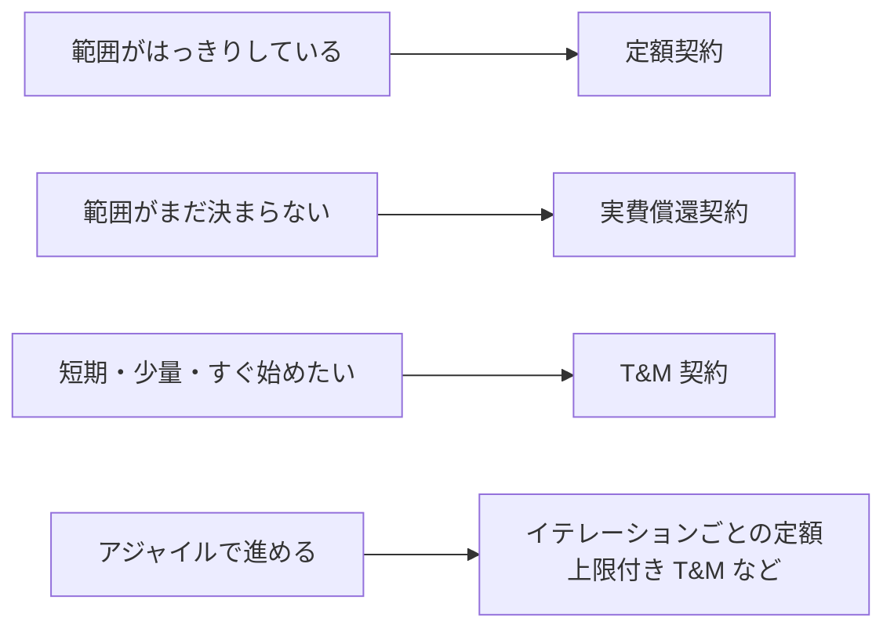
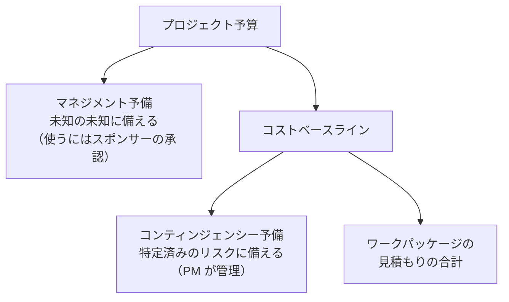
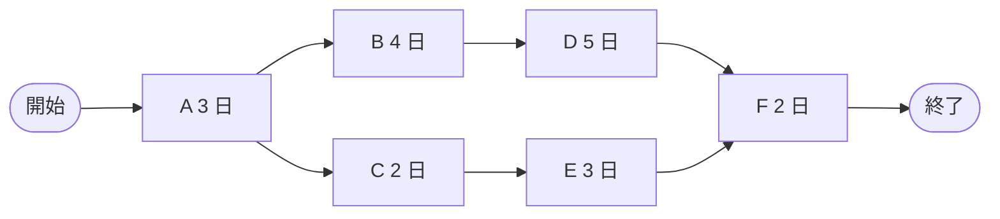
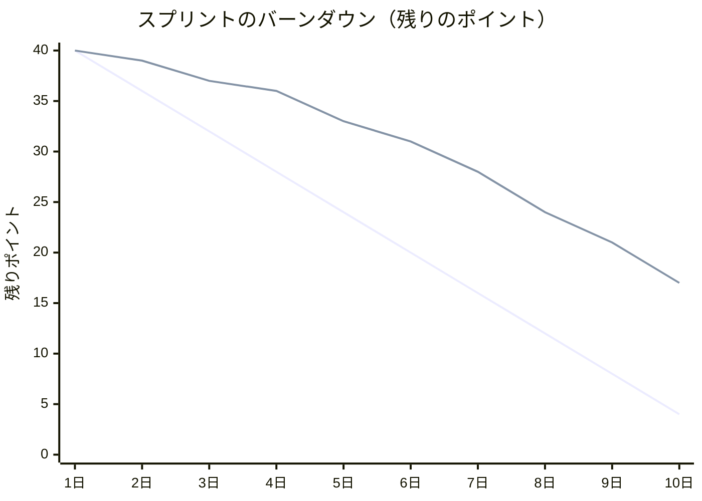

## はじめに：この範囲で学ぶこと

「プロセス（Process）」は配点 41% で、**3 つの領域のうち最も大きい**範囲です。公式の試験内容（ECO 2026）では 10 のタスクがあります。

PMP は「予測型 4 割・アジャイルとハイブリッド 6 割」

公式の試験内容では、約 40% が**予測型**（ウォーターフォール）、残り約 60% が**アジャイル型とハイブリッド型**の問題です。このレッスンでは、各タスクを**両方の進め方で**説明します。問題文を読んだら、まず「**このプロジェクトはどの進め方か**」を見極めましょう。

---

## 1. 進め方を選び、統合された計画を作る（タスク 1）

### 1-1. 3 つの進め方

| | **予測型**（ウォーターフォール） | **アジャイル型**（適応型） | **ハイブリッド型** |
|---|---|---|---|
| 要求 | 最初に**確定**できる | 進めながら**変わる・見つかる** | 部分によって違う |
| 計画 | 最初に詳しく立てる | 少し先まで詳しく、残りは粗く（段階的詳細化） | 部分ごとに使い分け |
| 変更 | 変更管理で慎重に扱う | **歓迎**し、バックログで優先順位を付け直す | 部分ごとに使い分け |
| 価値の届け方 | 最後にまとめて | **短い間隔で少しずつ** | 組み合わせ |
| 向いている例 | 建設、規制の厳しい装置の製造 | 新しいアプリ、顧客の反応を見たい製品 | ハードは予測型、ソフトはアジャイル |

なぜ？ 進め方は「好み」ではなく「状況」で選ぶ

要求が固まっていないのに最初に全部計画すると、作り直しが大量に出ます。逆に、建物の基礎のように**後から変えられないもの**を少しずつ作り直すことはできません。だから PM は、要求の確かさ・変更の起きやすさ・届け方の制約・リスク・組織の文化を見て、**進め方を提案（テーラリング）**します。

### 1-2. ライフサイクルの種類

| ライフサイクル | 特徴 |
|---|---|
| **予測型** | 要件 → 設計 → 構築 → テスト → 引き渡し を順番に行う |
| **反復型** | 同じ範囲を何度も作り直して**完成度を上げる**（試作を重ねる） |
| **漸進型** | 機能を**少しずつ追加して**届ける |
| **アジャイル** | 反復型＋漸進型。短い期間（スプリント・イテレーション）ごとに、使える成果物を届ける |

### 1-3. 統合された計画

| 文書 | 役割 |
|---|---|
| **プロジェクト憲章** | プロジェクトを正式に認め、**PM に権限を与える**。スポンサーが発行する |
| **プロジェクトマネジメント計画書** | スコープ・スケジュール・コスト・品質・資源・コミュニケーション・リスク・調達・ステークホルダーの各計画と、**ベースライン（スコープ・スケジュール・コスト）**をまとめたもの |
| **ベースライン** | 承認された計画。**変更管理を通さないと変えられない**。実績と比べる基準になる |

アジャイルでは、詳しい計画書の代わりに**プロダクトビジョン・プロダクトロードマップ・リリース計画・プロダクトバックログ**が計画の役割を果たします。

### 1-4. 作業量を見積もる

| 手法 | 内容 | 向いている場面 |
|---|---|---|
| **類推見積もり** | 似た過去のプロジェクトから見積もる。速いが粗い | 初期で情報が少ない |
| **パラメトリック見積もり** | 単価 × 量（例: 1 画面 3 日 × 20 画面） | 過去のデータがそろっている |
| **三点見積もり** | 楽観値（O）・最頻値（M）・悲観値（P）を使う | 不確かさを数字にしたい |
| **ボトムアップ見積もり** | 細かい作業ごとに見積もって積み上げる。正確だが時間がかかる | WBS ができている |
| **ストーリーポイント** | 作業の**相対的な大きさ**で見積もる（アジャイル） | チームで見積もる |
| **プランニングポーカー／T シャツサイズ／アフィニティ見積もり** | チームで合意しながら相対的に見積もる | アジャイルのバックログ |

計算例：三点見積もり

ある作業の楽観値 4 日、最頻値 6 日、悲観値 14 日。

- **ベータ分布（PERT）**：(O + 4M + P) ÷ 6 ＝ (4 + 24 + 14) ÷ 6 ＝ **7 日**
- **三角分布**：(O + M + P) ÷ 3 ＝ (4 + 6 + 14) ÷ 3 ＝ **8 日**
- **標準偏差（PERT）**：(P − O) ÷ 6 ＝ 10 ÷ 6 ≒ **1.7 日**

問題文に指定がなければ、PERT（4 倍する式）を使うことが多いです。

### 1-5. 判断に使う情報を決める

ECO では、**持続可能性（サステナビリティ）**などの重要な情報要件を決めることも挙げられています。環境への影響、エネルギー使用量、地域社会への配慮などを、最初から計画に入れておきます。また、**データを集めて分析し、判断する**（勘や声の大きさで決めない）ことが求められます。

---

## 2. スコープを定義しマネジメントする（タスク 2）

### 2-1. 予測型のスコープ

| 用語 | 意味 |
|---|---|
| **スコープ記述書** | 成果物、受け入れ基準、**範囲外**、前提条件、制約を書く |
| **WBS**（作業分解構成図） | 成果物を階層的に分解したもの。最下層を**ワークパッケージ**と呼ぶ |
| **100% ルール** | WBS の下位の合計は、上位の**すべて**を表す。漏れも余分もない |
| **WBS 辞書** | 各ワークパッケージの説明、責任者、受け入れ基準など |
| **要求事項トレーサビリティ・マトリックス** | 要求が、どの成果物・テストで満たされるかを追跡する表 |

ひっかけ注意：スコープの妥当性確認と品質コントロール

- **品質コントロール**：成果物が**正しく作られているか**をチームが確かめる（社内の検査）
- **スコープの妥当性確認**：完成した成果物を**顧客・スポンサーが正式に受け入れる**

順番は「品質コントロール → スコープの妥当性確認」です。顧客の受け入れ前に、まず社内で正しさを確かめます。

### 2-2. アジャイルのスコープ

- **プロダクトバックログ**：やることの一覧。**プロダクトオーナーが優先順位を付ける**
- **受け入れ基準**：ストーリーごとの「できた」の条件
- **完成の定義（DoD）**：すべてのストーリーに共通する品質の約束（テスト済み、レビュー済み など）
- **バックログリファインメント**：ストーリーを詳しくし、見積もり、並べ直す継続的な活動

なぜ？ アジャイルは「スコープが変わる」前提

予測型は**スコープを固定**して、時間とコストを見積もります。アジャイルは**時間（スプリントの長さ）とチームの人数（コスト）を固定**して、その中で**価値の高いものから**作ります。だからスコープは変わってよく、変更はバックログの並べ替えで吸収します。

### 2-3. スコープクリープを防ぐ

**スコープクリープ**は、正式な手続きを経ずに範囲がなし崩しに広がることです。予測型では**変更管理**、アジャイルでは**バックログを通して PO が優先順位を判断**することで防ぎます。チームが頼まれていない機能を足す**ゴールドプレーティング**も避けます。

---

## 3. 価値に基づくデリバリーを確実にする（タスク 3）

### 3-1. 価値をはっきりさせる

| 文書・道具 | 内容 |
|---|---|
| **ビジネスケース** | なぜこのプロジェクトをやるのか。費用と得られる価値の比較 |
| **ベネフィットマネジメント計画** | 価値（ベネフィット）を**いつ・どう測り・誰が責任を持つか** |
| **OKR／KPI** | 目標と、達成を測る指標 |

### 3-2. 価値で優先順位を付ける

| 手法 | 内容 |
|---|---|
| **MoSCoW** | Must（必須）・Should（重要）・Could（あれば良い）・Won't（今回はしない） |
| **狩野モデル** | 当たり前品質（ないと不満）・一元的品質（多いほど満足）・魅力的品質（あると感動） |
| **価値 × 工数** | 価値が高く工数が小さいものから |
| **遅延コスト（Cost of Delay）** | 遅れるとどれだけ価値が失われるか |

### 3-3. 少しずつ届けて確かめる

- **MVP**：価値を確かめるのに必要な**最小限**の製品。早く出して学ぶ
- **漸進的なデリバリー**：使える機能から順番に届け、早く価値を出す
- ビジネス価値は**プロジェクト中ずっと**確かめる

具体例：価値がなくなったとき

新しい予約システムを作っている途中で、会社が予約サービスそのものをやめることになりました。計画どおりに作り続けても、ビジネス価値はありません。PM はビジネスケースを見直し、**スポンサーにプロジェクトの中止（または方向転換）を提案**します。PM が自分の判断で中止するのではなく、**判断の材料を示して、スポンサーが決める**のがポイントです。

### 3-4. 財務の指標（ビジネスケースで使う）

| 指標 | 意味 | 選び方 |
|---|---|---|
| **ROI**（投資利益率） | 投資に対する利益の割合 | 大きいほど良い |
| **NPV**（正味現在価値） | 将来のお金を今の価値に直した、利益の合計 | **大きいほど良い**。マイナスならやらない |
| **IRR**（内部収益率） | NPV がゼロになる割引率 | 大きいほど良い |
| **回収期間** | 投資を回収するまでの期間 | 短いほど良い |

NPV がすでに期間を考慮しているので、プロジェクトの期間の長さで割り引く必要はありません。

---

## 4. 資源を計画しマネジメントする（タスク 4）

| 用語 | 意味 |
|---|---|
| **資源マネジメント計画** | 人・設備・材料を、どう集め、管理し、手放すか |
| **資源カレンダー** | いつ誰（何）が使えるか。休暇、他プロジェクトの予定 |
| **事前割り当て** | 契約や約束で、最初から決まっているメンバー |
| **資源平準化** | 資源の取り合いを解消するため作業をずらす。**クリティカルパスが延びることがある** |
| **資源円滑化** | フロート（余裕）の範囲内で作業をずらす。**完了日は変わらない** |

具体例：必要な人が足りない

データ移行の専門家が来月から別プロジェクトに移ることが分かりました。PM はまず**影響（どの作業がいつ止まるか）を分析**し、機能部門のマネージャーと調整します。選択肢は、作業の前倒し、他のメンバーへの知識の移転、外部からの調達などです。影響を示さずに「人を出してほしい」と頼むだけでは交渉できません。

---

## 5. 調達を計画しマネジメントする（タスク 5）

### 5-1. 調達の流れ

| 文書 | 内容 |
|---|---|
| **RFI**（情報提供依頼） | 何ができるか情報を集める |
| **RFQ**（見積依頼） | 仕様が決まっていて、**価格**を比べたい |
| **RFP**（提案依頼） | 解決策の**提案**を求める。価格以外も評価する |
| **SOW**（作業範囲記述書） | 外部に頼む作業の範囲を詳しく書く |
| **入札説明会** | すべての候補に**同じ情報を同時に**伝え、公平にする |

### 5-2. 契約の種類とリスク（頻出）

| 契約の種類 | 内容 | 買い手のリスク |
|---|---|---|
| **完全定額（FFP）** | 決まった金額で完成させる | **最も小さい**（売り手が負う） |
| **定額インセンティブ（FPIF）** | 定額＋成果に応じた報奨 | 小さい |
| **経済価格調整付き定額（FP-EPA）** | 長期契約で、物価の変動を反映する | 小さい |
| **タイム・アンド・マテリアル（T&M）** | 時間単価 × 時間＋材料費 | 中くらい。**範囲が決まっていない小さな作業**向き |
| **コスト・プラス・インセンティブ（CPIF）** | 実費＋成果に応じた報酬 | 大きい |
| **コスト・プラス・アワード（CPAF）** | 実費＋買い手が判断する報奨 | 大きい |
| **コスト・プラス定額報酬（CPFF）** | 実費＋決まった報酬 | **最も大きい**（費用が増えるほど払う） |

ポイント：アジャイルの契約

アジャイルでは範囲が変わる前提なので、**スプリント（増分）ごとに価格を決める**、**上限付きの T&M**、**早期終了を認める条項**（価値が十分出たら残りを払わずに終われる）、**変更を無償で受け入れる条項**（同じ大きさの作業と入れ替える）などが使われます。

### 5-3. 契約を管理する

- 契約の変更・紛争は**契約の条項に沿って**扱う。口頭で約束しない
- 売り手の実績（品質・納期・コスト）を定期的に評価する
- 紛争は**交渉で解決**するのが基本。解決しなければ調停・仲裁などの手続きへ
- 調達を終えるときは、検収、未解決の請求の解消、記録の保管、教訓の記録を行う

ひっかけ注意：ベンダーへの直接の指示

契約の範囲外の作業を、PM がベンダーに口頭で頼むのは誤りです。範囲外の作業は**契約変更**として正式に扱います。また、売り手の担当者を自分の部下のように直接指示することも避け、契約の窓口を通します。

---

## 6. 財務を計画しマネジメントする（タスク 6）

### 6-1. 予算の構造

| 予備費 | 備える対象 | 含まれる場所 | 使う権限 |
|---|---|---|---|
| **コンティンジェンシー予備** | 特定済みのリスク（既知の未知） | **コストベースラインの中** | PM |
| **マネジメント予備** | 予想していなかった出来事（未知の未知） | **ベースラインの外**（予算の中） | スポンサー・経営 |

### 6-2. アーンドバリュー（EVM）（計算問題）

| 記号 | 意味 |
|---|---|
| **PV**（計画価値） | 今日までに**終わる予定だった**作業の予算 |
| **EV**（アーンドバリュー） | 今日までに**実際に終わった**作業の予算 |
| **AC**（実コスト） | 今日までに**実際にかかった**費用 |
| **BAC**（完成時総予算） | 全体の予算 |

| 指標 | 式 | 読み方 |
|---|---|---|
| **CV**（コスト差異） | EV − AC | マイナスなら**予算超過** |
| **SV**（スケジュール差異） | EV − PV | マイナスなら**遅れ** |
| **CPI**（コスト効率指数） | EV ÷ AC | 1 未満なら**予算超過** |
| **SPI**（スケジュール効率指数） | EV ÷ PV | 1 未満なら**遅れ** |
| **EAC**（完成時総コスト見込み） | BAC ÷ CPI | 今の効率が続いた場合 |
| **ETC**（残作業のコスト見込み） | EAC − AC | |
| **VAC**（完成時差異） | BAC − EAC | マイナスなら最終的に予算超過 |
| **TCPI**（残作業効率指数） | (BAC − EV) ÷ (BAC − AC) | 予算内に収めるのに必要な効率。1 より大きいほど厳しい |

計算例

予算（BAC）1,000 万円のプロジェクト。今日の時点で全体の 50% が終わる予定でしたが、実際には 40% しか終わっておらず、費用は 500 万円かかっています。

- PV ＝ 1,000 × 50% ＝ 500、EV ＝ 1,000 × 40% ＝ 400、AC ＝ 500
- CV ＝ 400 − 500 ＝ **−100**（予算超過）、SV ＝ 400 − 500 ＝ **−100**（遅れ）
- CPI ＝ 400 ÷ 500 ＝ **0.8**、SPI ＝ 400 ÷ 500 ＝ **0.8**
- EAC ＝ 1,000 ÷ 0.8 ＝ **1,250 万円**、ETC ＝ 1,250 − 500 ＝ **750 万円**
- VAC ＝ 1,000 − 1,250 ＝ **−250 万円**
- TCPI ＝ (1,000 − 400) ÷ (1,000 − 500) ＝ **1.2**（今より 1.5 倍近く効率を上げないと予算内に収まらない）

覚え方

- 差異（V）は**引き算**、指数（I）は**割り算**
- どれも **EV が先頭**（EV − AC、EV ÷ PV など）
- 差異はプラス、指数は 1 以上なら「良い」

### 6-3. 差異を監視し、ガバナンスと連携する

差異が**決められたしきい値**（例: CPI が 0.9 を下回る）を超えたら、原因を分析し、是正策を考え、必要ならガバナンス（ステアリングコミッティ・スポンサー）に報告します。アジャイルでは、**スプリントあたりのコスト（バーンレート）**と、届けた価値を比べて判断します。

---

## 7. 成果物の品質を計画し最適化する（タスク 7）

### 7-1. 品質の基本

| 考え方 | 内容 |
|---|---|
| **品質とグレード** | 品質＝要求を満たしているか。グレード＝機能や等級の高さ。**低グレードは問題ないが、低品質は問題** |
| **予防は検査に勝る** | 作ってから見つけるより、**作り方で防ぐ**ほうが安い |
| **品質マネジメント**（QA） | プロセスが正しく守られているかを確かめ、改善する |
| **品質コントロール**（QC） | 成果物を検査し、要求を満たすか確かめる |

### 7-2. 品質コスト（CoQ）

| 分類 | 内容 | 例 |
|---|---|---|
| **適合コスト**（防ぐため） | 予防コスト | 研修、手順書、品質の良い道具 |
| | 評価コスト | テスト、検査、レビュー |
| **不適合コスト**（失敗したため） | 内部失敗コスト | 手直し、作り直し、廃棄 |
| | 外部失敗コスト | 保証対応、クレーム、**信用の低下**（最も高くつく） |

### 7-3. 品質の道具

| 道具 | 使い方 |
|---|---|
| **特性要因図**（フィッシュボーン） | 問題の原因を分類して洗い出す |
| **パレート図** | 原因を件数の多い順に並べ、**上位の少数（約 20%）が大半（約 80%）を占める**ことを見つける |
| **管理図** | 工程が安定しているかを見る。**管理限界**の外に出る、または**平均の片側に 7 点続く**と調査が必要 |
| **ヒストグラム** | ばらつきの分布を見る |
| **散布図** | 2 つの変数の関係を見る |
| **チェックシート** | 発生回数を数えて記録する |

ひっかけ注意：管理限界と仕様限界

- **管理限界**：工程のばらつきから計算する（平均 ±3σ）。**工程が安定しているか**の判断に使う
- **仕様限界**：顧客の要求で決まる。**合格・不合格**の判断に使う

管理限界の中でも仕様を満たさないことや、その逆もあります。

### 7-4. 規制の順守、持続可能性、継続的な改善

- 規制がある製品では、品質の要求に**規制の要件**を入れ、順守を記録する
- **持続可能性**（環境負荷、資源の使い方）も品質の観点として管理する
- **PDCA**（計画・実行・評価・改善）や**カイゼン**で、小さな改善を続ける
- アジャイルでは、**完成の定義**、テスト自動化、継続的インテグレーション、**振り返り**で品質を作り込む

---

## 8. スケジュールを計画しマネジメントする（タスク 8）

### 8-1. 作業の順番（依存関係）

| 関係 | 意味 | 例 |
|---|---|---|
| **FS**（終了 − 開始） | A が終わったら B を始める。**最もよく使う** | 壁を作ってから塗る |
| **SS**（開始 − 開始） | A が始まったら B を始められる | 設計が始まったら調査も始める |
| **FF**（終了 − 終了） | A が終わったら B も終われる | テストが終わったら文書も確定 |
| **SF**（開始 − 終了） | A が始まったら B を終えられる。**まれ** | 新システムが動き始めたら旧システムの運用を終える |

- **リード**：後の作業を前倒しで始める（重ねる）
- **ラグ**：後の作業を待たせる（例: コンクリートが固まるまで 2 日待つ）

### 8-2. クリティカルパス法（計算問題）

| 経路 | 日数 |
|---|---|
| A → B → D → F | 3 + 4 + 5 + 2 ＝ **14 日**（最長＝**クリティカルパス**） |
| A → C → E → F | 3 + 2 + 3 + 2 ＝ 10 日 |

- **クリティカルパス**：最も長い経路。この経路の作業が遅れると、**プロジェクト全体が遅れる**
- **トータルフロート**：プロジェクトの完了を遅らせずに、その作業を遅らせられる日数。上の C と E は **14 − 10 ＝ 4 日**
- クリティカルパス上の作業のフロートは**ゼロ**

### 8-3. スケジュールを短くする

| 方法 | 内容 | 代償 |
|---|---|---|
| **クラッシング** | 人や費用を追加して作業を短くする | **コストが増える** |
| **ファストトラッキング** | 順番に行う作業を**並行して**進める | **リスク・手戻りが増える** |

どちらも**クリティカルパス上の作業**に行わないと、全体は短くなりません。

### 8-4. アジャイルのスケジュール

- **リリース計画**：いくつのスプリントで、どの機能を届けるか
- **ベロシティ**：1 スプリントで終えたストーリーポイントの量。**チームごとに違い、チーム間で比べない**
- **見通し**：残り 200 ポイント ÷ ベロシティ 25 ＝ **約 8 スプリント**
- **タイムボックス**：スプリントの長さは固定。終わらなかった作業はバックログに戻す
- **かんばん**：**WIP 制限**（同時に進める作業の上限）で流れを良くする。**リードタイム**（依頼から完了まで）と**サイクルタイム**（作業開始から完了まで）を測る

### 8-5. 他のプロジェクトや業務と調整し、差異を分析する

- 共有する資源、依存する他プロジェクトの納期、業務の繁忙期（決算期など）を確かめる
- **過去のデータ（ベンチマーク）**を見積もりに生かす
- 承認されたスケジュールを**ベースライン**にし、SPI やマイルストーンの遅れで差異を分析する

---

## 9. プロジェクトの状況を評価する（タスク 9）

### 9-1. メトリクス

| 予測型 | アジャイル |
|---|---|
| CPI・SPI・差異 | **バーンダウン／バーンアップチャート** |
| マイルストーンの達成状況 | ベロシティ、スループット |
| 欠陥の数 | **累積フロー図**（作業のたまり具合） |

上の図で、**灰色が理想の線、青が実績**です。実績が理想より**上にある＝遅れ**ています。スクラムマスターはデイリースタンドアップで障害を確かめ、PO とスコープを相談します。

| チャート | 見るもの |
|---|---|
| **バーンダウン** | 残りの作業が減っているか。線が下がらなければ作業が終わっていない |
| **バーンアップ** | 終わった作業と、全体のスコープの 2 本の線。**スコープの増加が見える** |
| **累積フロー図** | 帯が太くなる工程＝**ボトルネック** |

### 9-2. アーティファクト（成果物・記録）を管理する

| アーティファクト | 中身 |
|---|---|
| **課題ログ** | 起きている問題、担当者、期限 |
| **リスク登録簿** | 特定したリスクと対応策 |
| **前提条件ログ** | 前提と制約 |
| **変更ログ** | 変更要求と結果 |
| **教訓登録簿** | プロジェクト中に得た学び |

ECO では、必要なアーティファクトを**選んで（テーラリング）**、作成・レビュー・更新し、**関係者がアクセスできる**ようにすることが求められます。作りすぎも、足りないのも問題です。

ひっかけ注意：悪い状況を隠す・数字を良く見せる

遅れや予算超過を報告で隠す、緑（順調）に塗り替える、という選択肢は**どんな理由でも誤り**です。PMI の倫理（正直さ）に反します。悪い情報ほど**早く・正確に**伝え、対応策とあわせて示します。

---

## 10. プロジェクトの終結をマネジメントする（タスク 10）

| すること | 内容 |
|---|---|
| **終結の基準を決める** | 何がそろったら終われるか（受け入れ、引き継ぎ、支払いなど）を事前に決める |
| **完了の承認** | スポンサー・顧客の**正式な承認**を得る |
| **移行の準備** | 運用チームへの引き継ぎ（手順書、研修、サポート体制）を確かめる |
| **終結作業** | 調達の終結、財務の締め、資源の解放、教訓・振り返り、記録の保管 |

ポイント：途中で中止になっても終結する

プロジェクトが途中で中止になっても、**終結のプロセスは行います**。どこまで終わったかを記録し、契約を締め、教訓を残します。次のプロジェクトにとって、中止の理由こそ大切な学びです。

やってみよう（30 分・紙とペンで）

1. 自分の担当業務か身近なイベント（例: 社内勉強会の開催）を題材に、WBS を 3 階層で書く
2. ワークパッケージを 6 つ選び、日数と依存関係を決めて、ネットワーク図とクリティカルパスを求める
3. そのうち 1 つに三点見積もり（楽観・最頻・悲観）を当てはめ、PERT の値を計算する
4. 「予算 200 万円、今日の予定 60%、実績 50%、費用 130 万円」で CV・SV・CPI・SPI・EAC を計算する（答え：CV −30、SV −20、CPI ≒ 0.77、SPI ≒ 0.83、EAC ≒ 260 万円）
5. 同じ題材をアジャイルで進めるなら、最初のスプリントで何を届けるか（MVP）を考える

---

## 11. まとめ

| テーマ | 覚えること |
|---|---|
| 進め方 | 要求の確かさ・変更・届け方で選ぶ。予測型 4 割、アジャイルとハイブリッド 6 割 |
| 計画 | 憲章が PM に権限を与える。ベースラインは変更管理で変える |
| 見積もり | 類推・パラメトリック・三点（PERT は (O+4M+P)/6）・ボトムアップ・ストーリーポイント |
| スコープ | 記述書＋WBS＋辞書。100% ルール。品質コントロール → 妥当性確認 |
| アジャイルのスコープ | バックログは PO が並べる。受け入れ基準と完成の定義 |
| 価値 | ビジネスケースとベネフィット。MVP で早く学ぶ。価値がなくなればスポンサーに提案 |
| 資源 | 平準化は完了日が延びうる、円滑化はフロート内 |
| 調達 | RFI・RFQ・RFP。定額は買い手のリスク小、CPFF は大。範囲外の作業は契約変更 |
| 財務 | コンティンジェンシーはベースライン内で PM、マネジメント予備は外でスポンサー |
| EVM | CV＝EV−AC、SV＝EV−PV、CPI＝EV/AC、SPI＝EV/PV、EAC＝BAC/CPI |
| 品質 | 予防は検査に勝る。品質コスト 4 分類。管理図の 7 点ルール |
| スケジュール | クリティカルパスとフロート。クラッシングはコスト、ファストトラッキングはリスク |
| アジャイルの見通し | ベロシティはチームの中だけで使う。WIP 制限 |
| 状況 | バーンダウン・バーンアップ・累積フロー図。悪い情報ほど早く正確に |
| 終結 | 正式な承認、移行、調達と財務、教訓。中止でも終結する |

## 試験直前チェック

- [ ] 予測型・アジャイル型・ハイブリッド型を選ぶ基準を言える
- [ ] プロジェクト憲章とプロジェクトマネジメント計画書の違いを言える
- [ ] 三点見積もり（PERT と三角分布）を計算できる
- [ ] WBS の 100% ルールとワークパッケージを説明できる
- [ ] 品質コントロールとスコープの妥当性確認の違いと順番を言える
- [ ] 受け入れ基準と完成の定義（DoD）の違いを言える
- [ ] MVP の目的を説明できる
- [ ] 価値がなくなったときに PM がすることを言える
- [ ] 資源平準化と資源円滑化の違いを言える
- [ ] RFI・RFQ・RFP の違いを言える
- [ ] 契約の種類を買い手のリスクの小さい順に並べられる
- [ ] コンティンジェンシー予備とマネジメント予備の違いを言える
- [ ] CV・SV・CPI・SPI・EAC・ETC・VAC・TCPI を計算できる
- [ ] 品質コストの 4 分類を言える
- [ ] 管理限界と仕様限界の違い、7 点ルールを言える
- [ ] FS・SS・FF・SF の違いを言える
- [ ] クリティカルパスとフロートを求められる
- [ ] クラッシングとファストトラッキングの違いを言える
- [ ] ベロシティからスプリント数を見積もれる。チーム間で比べない理由を言える
- [ ] バーンダウン・バーンアップ・累積フロー図の読み方を言える
- [ ] 終結で行うことを 4 つ言える。中止のときも終結する理由を言える
