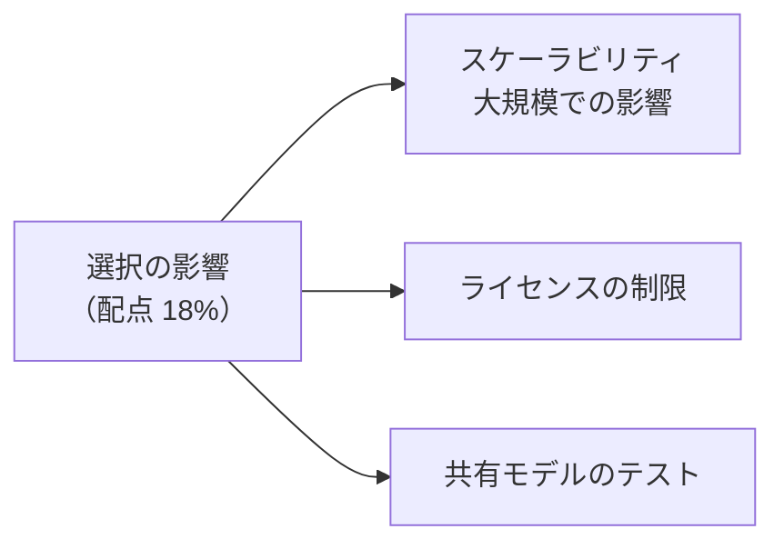
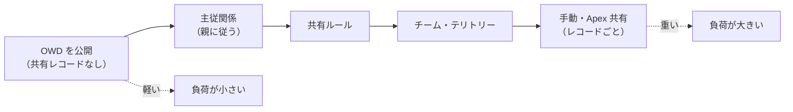
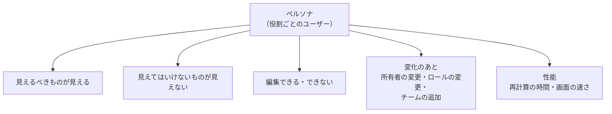

## はじめに：この範囲で学ぶこと

「セキュリティモデルの選択の影響」は配点 **18%** です。

---

## 1. 共有の仕組みの「重さ」

共有は、裏側で**共有テーブル**（どのユーザー・グループがどのレコードにアクセスできるか）と**グループのメンバーシップ**を計算して持っています。仕組みを増やすほど、計算とデータが増えます。

### 1-1. 再計算が起きる操作

| 操作 | 影響 |
|---|---|
| **OWD の変更** | オブジェクト全体の共有を作り直す |
| **ロール階層の変更**（ロールの追加・移動） | そのロール以下のアクセスを作り直す |
| **ユーザーのロールの変更** | そのユーザーが所有するレコードのアクセスを作り直す |
| **共有ルールの追加・変更** | 対象のレコードの共有を作り直す |
| **公開グループのメンバーの変更** | グループを使う共有をすべて見直す |
| **所有者の変更** | そのレコードの共有を作り直す（手動共有は消える） |
| **テリトリーの再割り当て** | テリトリーのメンバーのアクセスを作り直す |

### 1-2. 大規模での負荷を減らす

| 手段 | 内容 |
|---|---|
| **OWD を公開にできるなら公開に** | 共有レコードを作らないので最も軽い |
| **親レコードによる制御** | 子の共有を親に任せる |
| **共有ルールの数を減らす** | 公開グループで共有先をまとめる |
| **ロール階層を深くしすぎない** | 深い階層は計算が重い |
| **グループの入れ子を浅く** | メンバーシップの計算が重くなる |
| **共有計算の延期** | 大量の変更の間は計算を止め、まとめて実行（機能の有効化が必要） |
| **作業の時間帯** | 業務時間外に大きな変更を行う |
| **データスキューを避ける** | 1 人・1 件に 1 万件を超えて集中させない |

### 1-3. データスキューと共有

| スキュー | 共有への影響 | 対策 |
|---|---|---|
| **所有権スキュー**（1 人が大量に所有） | そのユーザーのロール変更で大量の再計算 | 所有者を分散、所有者を**ロールなし**または子のない上位ロールに |
| **取引先スキュー**（1 つの取引先に大量の子） | 子の共有の計算とロックの競合 | 子を複数の取引先に分ける |
| **参照スキュー** | ロックの競合 | 参照先を分散 |

例

連携ユーザーが 500 万件の注文を所有し、営業部長のロールの下に入っていた。組織変更でそのロールを移したら、共有の再計算が何時間も続いた。→ 連携ユーザーを**ロールなし**にし、注文は OWD と共有ルールで必要な人に見せる設計に変える。

### 1-4. 仕組みごとの長所と短所

| 仕組み | 長所 | 短所 |
|---|---|---|
| **共有ルール** | 宣言的、保守しやすい | 数に上限、条件の項目の型に制限 |
| **チーム** | レコードごとに柔軟 | 共有レコードが増える、運用（メンバーの更新）が必要 |
| **テリトリー** | ルールで大量の取引先を割り当て | 再割り当ての計算が重い、設計が複雑 |
| **手動共有** | 簡単 | 所有者が変わると消える、管理しにくい |
| **Apex 共有** | 複雑な条件も可能 | 開発・テスト・保守、再計算の仕組みが必要 |
| **共有セット**（外部） | 大量の顧客でも軽い | 取引先・取引先責任者を通じた関係しか表せない |

---

## 2. ライセンスの制限

ライセンスによって、**使える共有の仕組み**や**アクセスできるオブジェクト**が違います。

| ライセンス | 共有の仕組みの制限 | 使えるオブジェクトの制限 |
|---|---|---|
| **Salesforce Platform** | 通常の共有 | 商談・リード・ケース・売上予測・キャンペーンなど CRM のオブジェクトは使えない |
| **Customer Community** | **ロールなし** → ロール階層・共有ルールの対象にならない。**共有セット**と**共有グループ**を使う | 商談・リードなどは使えない |
| **Customer Community Plus** | ロールあり（外部ロール階層）、共有ルール、レポート | 商談・リードは使えない |
| **Partner Community** | ロールあり、共有ルール、スーパーユーザー | **リード・商談・キャンペーン**が使える |
| **ゲストユーザー** | ゲストユーザー共有ルールのみ（参照のみ） | 最小限 |
| **Chatter Free など** | — | CRM のレコードにはアクセスできない |

ひっかけ注意

- 「Customer Community のユーザーに、共有ルールで別の取引先のケースを見せたい」→ ロールがないので**共有ルールは使えません**。共有セットで表せない関係なら、**Customer Community Plus** などのライセンスを検討します。
- 「代理店に商談を共有したい」→ **Partner Community**。
- 外部ユーザーのロールの階層の数（取引先ごとのロールの数）にも上限があり、多すぎるとロールの総数が増えて重くなります。

---

## 3. 共有モデルをテストする

### 3-1. テストの方法

| 方法 | 内容 |
|---|---|
| **ペルソナごとのテストユーザー** | 「営業担当者（東日本）」「営業部長」「パートナー」など、役割ごとにユーザーを用意 |
| **ログインして確認**（代理ログイン） | テストユーザーとしてログインし、見える・見えないを確かめる |
| **共有の詳細の確認** | レコードの共有の詳細（共有階層）で、**誰が・なぜ**アクセスできるかを見る |
| **UserRecordAccess の照会** | 特定のユーザーが特定のレコードにどのアクセス（参照・編集など）を持つかを SOQL で調べる |
| **アクセスの概要** | ユーザーに割り当てられた権限セット・権限の一覧を確認する |
| **Apex のテスト** | `System.runAs` で特定のユーザーとして実行し、アクセスできる・できないことを自動で確かめる |
| **本番と同じ量でのテスト** | Full サンドボックスで、再計算の時間や性能を測る |

### 3-2. 何をテストするか

| テストの観点 | 例 |
|---|---|
| **見えるべきもの** | 東日本の営業は東日本の商談を見られる |
| **見えてはいけないもの** | 東日本の営業は西日本の商談を見られない（「否定」のテストが大事） |
| **編集の可否** | 参照のみで共有された人は編集できない |
| **項目** | 年収の項目は人事以外に見えない（レポート・API でも） |
| **変化** | 所有者が変わったとき、ロールが変わったとき、チームから外れたときに、正しくアクセスが変わる |
| **外部ユーザー** | 顧客は自分の会社のケースだけ見られる |
| **性能** | 大量データで再計算が業務時間内に終わるか |

「見えないこと」のテストを忘れない

セキュリティのテストでは、「見えること」だけでなく、**見えてはいけないものが見えないこと**を確かめるのが重要です。レポート・リストビュー・検索・API など、**画面以外の入口**からも確認します。

---

## 4. まとめ

| テーマ | 覚えること |
|---|---|
| 重さ | OWD 公開 ＜ 主従 ＜ 共有ルール ＜ チーム・テリトリー ＜ 手動・Apex |
| 再計算 | OWD、ロール、ユーザーのロール、共有ルール、グループ、所有者、テリトリー |
| 負荷を減らす | 公開、親による制御、ルールを減らす、階層・入れ子を浅く、延期、時間外、スキューを避ける |
| ライセンス | Platform は CRM オブジェクト不可、Customer Community はロールなし（共有セット）、Plus はロール、Partner は商談 |
| テスト | ペルソナ、ログインして確認、共有の詳細、UserRecordAccess、runAs、否定のテスト、変化のテスト、性能 |

## 試験直前チェック

- [ ] 共有の再計算が起きる操作を 5 つ言える
- [ ] 大規模組織で共有の負荷を減らす手段を 5 つ言える
- [ ] 所有権スキューが共有に与える影響と対策を言える
- [ ] Customer Community と Customer Community Plus の共有の違いを言える
- [ ] 共有モデルのテスト方法を 4 つ言える
- [ ] 「見えてはいけないもの」のテストが大事な理由を言える
