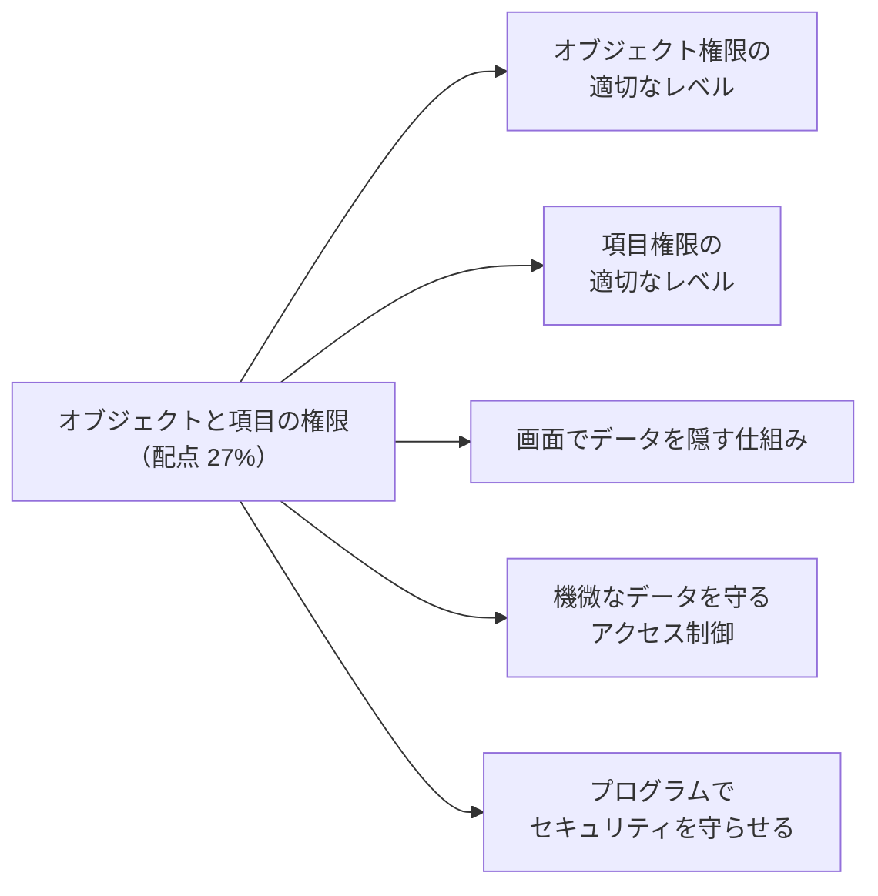
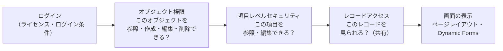

## はじめに：この範囲で学ぶこと

「標準・カスタムオブジェクトと項目の権限」は配点 **27%** です。

---

## 1. アクセスが決まる順番

- **オブジェクト権限**と**項目レベルセキュリティ**は「どの種類のデータか」、**レコードアクセス**は「どの行か」を決めます。
- どれか 1 つでも許可がなければ、データは見られません。
- **画面の表示**（レイアウト）は使いやすさのためで、**セキュリティではありません**。

---

## 2. オブジェクト権限

### 2-1. 権限の種類

| 権限 | できること |
|---|---|
| **参照** | 自分がアクセスできるレコードを見る |
| **作成** | 新しいレコードを作る（参照も必要） |
| **編集** | アクセスできるレコードを編集する |
| **削除** | アクセスできるレコードを削除する |
| **すべて参照** | そのオブジェクトの**全レコード**を参照（共有に関係なく） |
| **すべて変更** | そのオブジェクトの**全レコード**を参照・編集・削除・所有者の変更 |

### 2-2. 権限を付ける仕組み

| 仕組み | 役割 | 設計の考え方 |
|---|---|---|
| **プロファイル** | ユーザーに 1 つ。ログインの条件、既定のアプリ・レコードタイプなど | **最小限**の権限にする |
| **権限セット** | 追加の権限。複数を割り当てられる | 役割・業務ごとに作って足していく |
| **権限セットグループ** | 権限セットを束ねて、職務（ペルソナ）単位で割り当てる | 「営業担当者」「サービスリーダー」などの単位 |
| **ミュート権限セット** | 権限セットグループの中の特定の権限だけを**打ち消す** | グループを使い回しつつ、一部の人から削除権限だけ外す |
| **有効期限付きの割り当て** | 決めた日時に自動で外れる | 一時的なプロジェクト、代理 |
| **セッションベースの権限セット** | 特定の条件のセッションでだけ有効 | 多要素認証でログインしたときだけ機微なデータを編集できる |

Salesforce が推奨する設計

**最小限のプロファイル**＋**職務ごとの権限セットグループ**。権限は**足し算**で決まるので、プロファイルで広く与えて一部を引く、という設計はできません（引きたい場合はミュート権限セットを使います）。

### 2-3. 強い権限（共有を上書きするもの）

| 権限 | 範囲 | 注意 |
|---|---|---|
| **すべて参照・すべて変更**（オブジェクト単位） | 特定のオブジェクトの全レコード | 「経理チームは全請求を見る」など、範囲を絞って使える |
| **すべてのデータの参照**（View All Data） | 組織の**全データ** | 管理者・監査担当に限る |
| **すべてのデータの編集**（Modify All Data） | 組織の全データの編集 | 管理者に限る |
| **すべてのユーザーの参照** | 全ユーザーを参照 | ユーザーの共有設定を上書き |

ひっかけ注意

「1 つのオブジェクトの全レコードを見せたい」→ **View All Data（組織全体）ではなく、そのオブジェクトの「すべて参照」**。必要な範囲を超える権限は与えません。

---

## 3. 項目権限（項目レベルセキュリティ）

| 設定 | 意味 |
|---|---|
| **参照可能** | 項目の値を見られる |
| **参照のみ** | 見られるが編集できない |
| **参照不可** | 項目そのものが見えない |

- 項目レベルセキュリティは、**画面・レポート・リストビュー・検索・API**の**すべて**に効きます。
- 設定はプロファイル・権限セットで行います。**権限セットで項目のアクセスを管理**するのが推奨です。

### 3-1. よくある誤解

| 誤解 | 正しくは |
|---|---|
| ページレイアウトで項目を外せば見られない | **レポートや API では見える**。隠すなら項目レベルセキュリティ |
| ページレイアウトで「参照のみ」にすれば編集できない | **API・インポート・リストビューのインライン編集では編集できる**ことがある。項目レベルセキュリティで制御 |
| 数式項目は参照先の項目の権限に従う | **数式項目自体**が見えれば、参照先が見えなくても**計算結果は表示される** |

数式項目の落とし穴

「年収」項目は人事だけが見られる設定。しかし誰でも見られる数式項目「年収ランク（年収が 1,000 万以上なら A）」を作ると、年収そのものは見えなくても**ランクから推測**できてしまいます。数式項目にも同じ項目レベルセキュリティを設定します。

---

## 4. 画面でデータを隠す仕組み（UI レベル）

| 仕組み | 用途 |
|---|---|
| **ページレイアウト** | 項目・関連リスト・ボタンの配置と表示 |
| **レコードタイプ** | 業務ごとにレイアウトと選択リストの値を変える |
| **Dynamic Forms・コンポーネントの表示条件** | 条件（項目の値、ユーザーの権限、端末）で項目やコンポーネントを出し分ける |
| **アプリケーション・タブの表示** | 不要なアプリやタブを見せない |
| **リストビューの公開範囲** | 特定のグループだけにリストビューを見せる |
| **クイックアクション・ボタンの表示** | 使える操作を絞る |

UI で隠すのはセキュリティではない

これらは**使いやすさ**のための仕組みです。画面に出ていなくても、権限があれば**レポート・API・検索・リストビュー**からデータに届きます。「見せてはいけない」データは、必ず**オブジェクト権限・項目レベルセキュリティ・共有**で守ります。試験では「画面から消したい（使いやすさ）」と「見せてはいけない（セキュリティ）」を区別させる問題がよく出ます。

---

## 5. 機微なデータを守るアクセス制御

| データ | 例 | 必要な対策の例 |
|---|---|---|
| **PCI**（カード情報） | クレジットカード番号 | **保存しない**（決済代行のトークンを持つ）。保存するならマスク表示・暗号化・ごく少数の権限 |
| **個人情報（PII）** | 氏名・住所・電話・生年月日・マイナンバー | 項目レベルセキュリティ、暗号化、必要な人だけ、出力の制限 |
| **HIPAA**（医療情報） | 病名・診療記録 | 暗号化、アクセスの記録、最小権限 |

| 仕組み | 内容 |
|---|---|
| **項目レベルセキュリティ** | 見られる人を絞る（基本） |
| **Shield Platform Encryption** | 保存時の暗号化。権限のある人には通常どおり表示 |
| **クラシック暗号化項目** | 「暗号化された項目の参照」権限がない人には**マスク表示**（例：下 4 桁だけ） |
| **制限ルール** | 機微なレコードを、条件に合う人だけに絞る |
| **イベントモニタリング・Field Audit Trail** | 誰が見た・出した・変えたかを記録 |
| **トランザクションセキュリティのポリシー** | 大量のレポート出力などをブロック・通知 |
| **セッションベースの権限セット** | 多要素認証のセッションでだけ編集を許可 |
| **データマスキング** | サンドボックスで機微なデータを置き換え |

---

## 6. プログラムでセキュリティを守らせる

Apex は**既定でシステムモード**で動き、オブジェクト権限・項目レベルセキュリティを自動では確認しません。

| 方法 | 内容 |
|---|---|
| **ユーザーモードのクエリ・DML** | `WITH USER_MODE`、`insert as user` など。共有・オブジェクト権限・項目レベルセキュリティをまとめて適用 |
| **Security.stripInaccessible** | 権限のない項目を、結果から**取り除いて**から使う |
| **WITH SECURITY_ENFORCED** | 権限のない項目・オブジェクトがあるとエラーにする（従来の方法） |
| **スキーマの確認** | 項目・オブジェクトの権限を、処理の前に確認する |
| **with sharing** | レコードの共有を適用（オブジェクト・項目の権限は別） |
| **Lightning Data Service（LWC）** | 権限と共有を**自動で**守る |
| **Flow の実行コンテキスト** | ユーザーコンテキストで動かすと、ユーザーの権限が適用される |

ひっかけ注意

`with sharing` は**レコードの共有だけ**を適用します。**オブジェクト権限と項目レベルセキュリティは守られません**。両方を守るには、ユーザーモード（`WITH USER_MODE`）や `stripInaccessible` を使います。

---

## 7. まとめ

| テーマ | 覚えること |
|---|---|
| 順番 | オブジェクト → 項目 → レコード → 画面（画面はセキュリティではない） |
| オブジェクト | 最小プロファイル＋権限セットグループ、ミュート、有効期限、セッションベース |
| 強い権限 | オブジェクト単位のすべて参照・変更 ＜ View All Data・Modify All Data |
| 項目 | 項目レベルセキュリティは画面・レポート・API すべてに効く。数式項目に注意 |
| UI | レイアウト・レコードタイプ・Dynamic Forms は使いやすさのため |
| 機微なデータ | 持たない、FLS、暗号化、マスク、制限ルール、監視 |
| プログラム | ユーザーモード、stripInaccessible、with sharing は共有だけ、LDS は自動 |

## 試験直前チェック

- [ ] アクセスが決まる順番を言える
- [ ] ミュート権限セット・セッションベースの権限セットの使いどころを言える
- [ ] オブジェクト単位の「すべて参照」と View All Data の違いを言える
- [ ] ページレイアウトで隠すことがセキュリティにならない理由を言える
- [ ] 数式項目で情報が漏れる例を言える
- [ ] カード情報・個人情報を守る仕組みを 4 つ言える
- [ ] Apex でオブジェクト権限と項目レベルセキュリティを守る方法を 2 つ言える
