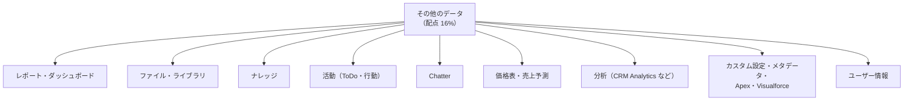

## はじめに：この範囲で学ぶこと

「その他のデータへのアクセス」は配点 **16%** です。公式の出題目標は「標準・カスタムオブジェクト以外のデータへのアクセス制御を判断する」の 1 つですが、対象は幅広くあります。

---

## 1. レポートとダッシュボード

### 1-1. フォルダーで共有する

| フォルダーの権限 | できること |
|---|---|
| **参照者** | レポート・ダッシュボードを見る |
| **編集者** | 見る・編集する・移動する |
| **管理者** | 上に加えて、フォルダーの共有設定を変える |

- 共有先：ユーザー、公開グループ、ロール、ロールと部下 など。
- **非公開のレポート**フォルダーは本人だけ。

### 1-2. レポートに表示されるデータ

- レポートは**実行したユーザーの権限**で表示されます。見られないレコードや項目は出ません。
- フォルダーを共有しても、**データへのアクセスが広がるわけではありません**。

### 1-3. ダッシュボードの表示ユーザー（重要）

| 設定 | 誰の権限でデータを表示するか | 注意 |
|---|---|---|
| **特定のユーザーとして表示** | 指定した 1 人のユーザー | 閲覧者は、**そのユーザーが見られるデータ**を見る。**機密データの露出**に注意 |
| **ダッシュボードの閲覧者として表示**（動的ダッシュボード） | 見ている本人 | 本人が見られるデータだけ。エディションごとに作れる数に上限 |

ひっかけ注意

「部長の権限で動くダッシュボードを、全社のフォルダーに置いた」→ 全社員が**部長の見られるデータ**（集計値や明細）を見られてしまいます。閲覧者ごとにデータを分けたいなら**動的ダッシュボード**にするか、フォルダーの共有を絞ります。

---

## 2. ファイルとライブラリ

| 共有のしかた | 内容 |
|---|---|
| **レコードに添付** | そのレコードにアクセスできる人が見られる（「レコードの設定に従う」） |
| **ユーザー・グループに共有** | 参照者（見る）、共同編集者（編集・新しいバージョン） |
| **ライブラリ** | ライブラリのメンバーと権限（参照者・作成者・管理者）で管理 |
| **公開リンク** | ログインなしで誰でも見られるリンク。社外に出す前にリスクを確認 |

- 共有を止めたいときは、共有の相手から外す、公開リンクを削除する。
- 「ファイルの公開リンクを作成できる」権限を絞ると、外部への持ち出しを防げます。

---

## 3. ナレッジ

| 制御 | 内容 |
|---|---|
| **データカテゴリの表示範囲** | 記事に付けた**データカテゴリ**ごとに、ロール・権限セット・プロファイルで見られる範囲を決める |
| **公開チャネル** | 内部アプリ、顧客（カスタマー）、パートナー、公開ナレッジベース |
| **レコードタイプ** | 記事の種類ごとのレイアウトと公開プロセス |
| **記事の状態** | 下書き・公開・アーカイブ。下書きは作成者・編集者だけ |
| **オブジェクト権限** | ナレッジの参照・作成・編集・公開など |

例

「製品 A の社内向けトラブルシュート記事を、パートナーには見せたくない」→ 記事を**内部アプリのチャネルだけ**で公開する。さらに、製品のデータカテゴリで、関係する部署だけが見られるように表示範囲を設定する。

---

## 4. 活動（ToDo・行動）

- 活動は**関連先のレコード**へのアクセスで見られるかが決まります（OWD は「親レコードによる制御」）。
- **プライベートな行動**（関連先なし・非公開にした予定）は、本人と上位者など限られた人だけ。
- **カレンダーの共有**で、他の人の予定の見え方（空き時間だけ、詳細まで）を決められます。
- ToDo・行動が「関連先なし」で作られると、所有者と上位ロールなどしか見られません。

---

## 5. Chatter

| 対象 | 見え方 |
|---|---|
| **レコードのフィード** | そのレコードにアクセスできる人が見られる |
| **公開グループ（Chatter）** | 社内の誰でも見て参加できる |
| **非公開グループ** | メンバーだけが投稿を見られる |
| **一覧に表示されないグループ** | メンバー以外には存在も見えない（機密プロジェクト） |
| **顧客を含むグループ** | 外部ユーザーが参加できる。社内情報の投稿に注意 |
| **プロフィール** | ユーザー情報の公開範囲で制御 |

---

## 6. 営業まわりの特別なデータ

| データ | 制御 |
|---|---|
| **価格表** | 価格表の**共有**（使用・参照のみ）。使える価格表を絞る |
| **売上予測** | 売上予測の階層（ロールまたはテリトリー）で上司が部下の予測を見る。**売上予測の共有**で他の人に見せる |
| **キャンペーン** | 「マーケティングユーザー」の設定と権限、共有 |
| **テリトリー** | テリトリーのメンバーと、テリトリーごとのアクセスレベル |

---

## 7. 分析のデータ

| 仕組み | 内容 |
|---|---|
| **CRM Analytics の行レベルのセキュリティ** | データセットに**セキュリティ述語**（条件）を設定し、ユーザーごとに見られる行を絞る |
| **共有の継承** | Salesforce の共有をそのまま分析のデータに引き継ぐ（対象オブジェクトなどに制限あり） |
| **アプリ（フォルダー）の共有** | ダッシュボードやデータセットのアプリ単位で共有 |
| **Data 360** | データスペース、権限セット、ポリシー |

分析では「データの取り込み」が抜け道になる

CRM Analytics などは、データを**取り込んで**から分析します。取り込むときは強い権限で読むことが多いので、何もしないと**元の共有が効かない**状態になります。セキュリティ述語や共有の継承で、元の共有と同じ範囲に絞ります。

---

## 8. 設定・コード・その他

| 対象 | 制御 |
|---|---|
| **カスタム設定** | 種類（リスト・階層）。階層型は組織・プロファイル・ユーザーごとの値。参照の権限 |
| **カスタムメタデータ型** | 設定値。参照の権限、パッケージでの保護 |
| **Apex クラス・Visualforce ページ** | プロファイル・権限セットで**実行できるか**を制御 |
| **カスタム権限** | 機能の利用を権限セットで制御（コードや入力規則から確認） |
| **アプリ・タブ** | 表示と利用の権限 |
| **リストビュー** | 公開範囲（自分だけ、全員、特定のグループ） |
| **メールテンプレート・ドキュメント** | フォルダーの共有 |
| **Experience Cloud サイト** | サイトのメンバー（プロファイル・権限セット）、ゲストユーザーのプロファイル |

---

## 9. ユーザー情報の見え方

| 制御 | 内容 |
|---|---|
| **ユーザーの OWD** | 社内ユーザー同士がお互いを見られるか（公開・非公開） |
| **外部ユーザーから見える内部ユーザー** | サイトのユーザーに、社内のユーザーを見せるか |
| **ユーザー共有ルール** | 特定のグループ同士だけで見えるように |
| **プロフィールの項目の公開** | 外部ユーザーに見せる個人情報（電話・メールなど）を選ぶ |
| **すべてのユーザーの参照** | ユーザーの共有を上書きして全員を見る権限 |

---

## 10. まとめ

| テーマ | 覚えること |
|---|---|
| レポート | フォルダー（参照者・編集者・管理者）。データは実行ユーザーの権限 |
| ダッシュボード | 特定のユーザーとして表示＝露出に注意、動的＝閲覧者の権限 |
| ファイル | レコードの設定に従う、参照者・共同編集者、ライブラリ、公開リンク |
| ナレッジ | データカテゴリの表示範囲、公開チャネル |
| 活動 | 関連先に従う。プライベートな行動 |
| Chatter | レコードのフィード、公開・非公開・一覧に表示されないグループ |
| 分析 | セキュリティ述語、共有の継承 |
| その他 | 価格表・売上予測の共有、カスタム設定、Apex クラス、カスタム権限、ユーザーの見え方 |

## 試験直前チェック

- [ ] レポートのフォルダーの 3 つの権限を言える
- [ ] ダッシュボードの表示ユーザーによる露出のリスクと対策を言える
- [ ] ナレッジの見え方を決める 2 つの仕組みを言える
- [ ] 活動の見え方が決まる仕組みを言える
- [ ] 一覧に表示されない Chatter グループの使いどころを言える
- [ ] CRM Analytics で行ごとにデータを絞る方法を言える
- [ ] Apex クラスの実行を制御する方法を言える
