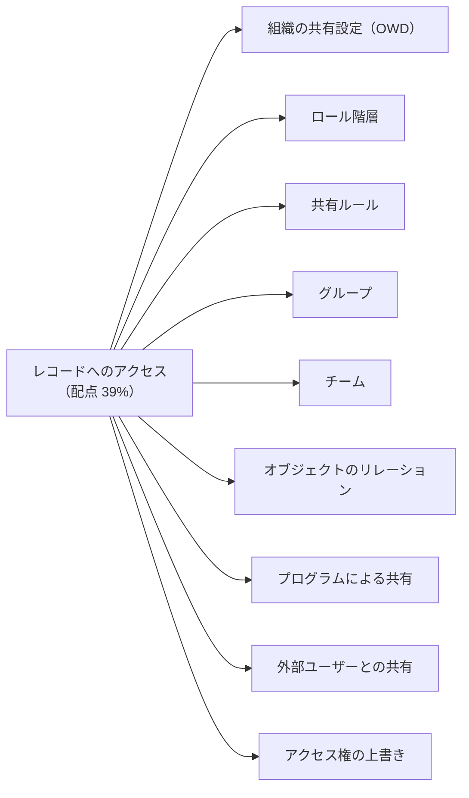
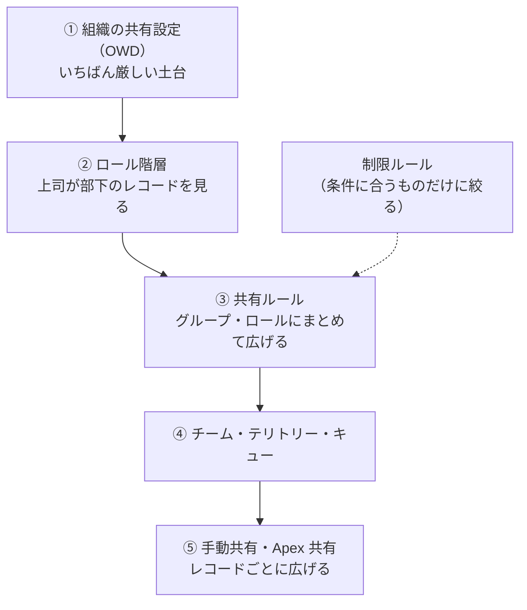
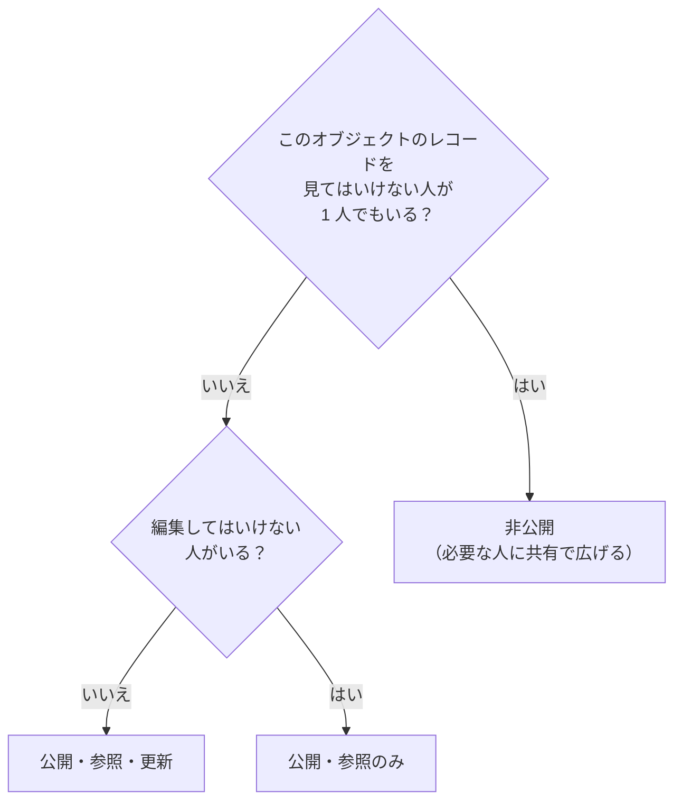
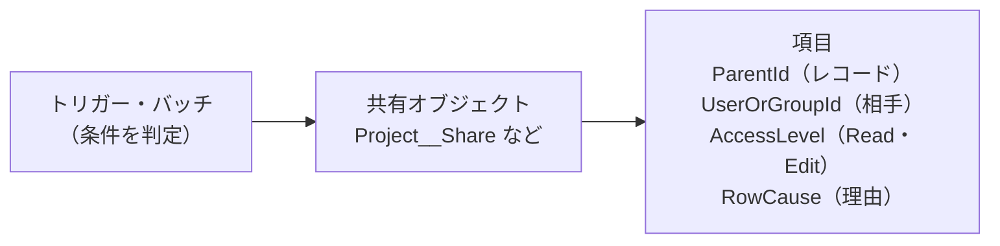

## はじめに：この範囲で学ぶこと

「レコードへのアクセス」は配点 **39%** で、試験の 4 割近くを占めます。公式の出題目標は 9 つあります。

---

## 1. 共有の全体像

- 共有の仕組みは、**OWD で最も厳しくして、他の仕組みで広げる**のが基本です。
- 広げる仕組みはすべて**足し算**です。一度広げたアクセスを、別の共有の仕組みで狭めることはできません（狭めるには**制限ルール**）。

---

## 2. 組織の共有設定（OWD）

| 設定 | 意味 |
|---|---|
| **非公開** | 所有者（と上位ロール、共有された人）だけ |
| **公開・参照のみ** | 全員が参照できる。編集は所有者など |
| **公開・参照・更新** | 全員が参照・編集できる |
| **公開・参照・更新・転送** | ケース・リードなどで、所有者の変更も全員ができる |
| **親レコードによる制御** | 主従関係の子、取引先責任者など。親へのアクセスに従う |

- **内部ユーザー用**と**外部ユーザー用**の OWD を別々に設定できます。外部は内部と**同じか、より厳しく**します。

### 2-1. OWD の決め方

「いちばん厳しい要件」に合わせる

全社員のうち 1 人でも見てはいけないなら、そのオブジェクトの OWD は**非公開**です。そのうえで、見てよい人には共有ルールなどで広げます。逆の順番（公開にして一部の人から隠す）はできません。

---

## 3. ロール階層

| ポイント | 内容 |
|---|---|
| 基本 | 上位のロールのユーザーは、**下位のロールのユーザーが所有（または共有された）レコード**にアクセスできる |
| 階層を使用したアクセス許可 | **カスタムオブジェクト**ではオフにできる（上司にも見せたくない場合）。標準オブジェクトでは常にオン |
| 設計 | 組織図ではなく、**データアクセスの階層**として作る |
| 取引先のロールの設定 | 取引先の所有者のロールに応じて、関連する商談・ケース・取引先責任者へのアクセスを決める設定がある |

ひっかけ注意

- 「同じロールの同僚同士でレコードを見せ合いたい」→ ロール階層は**上下**のアクセスなので、同じロールの横のアクセスにはなりません。**共有ルール**（所有者のロールで共有）を使います。
- 「部下の人事評価を上司にも見せたくない（カスタムオブジェクト）」→ **階層を使用したアクセス許可をオフ**。

---

## 4. 共有ルール

| 種類 | 基準 | 例 |
|---|---|---|
| **所有者ベース** | レコードの**所有者**のロール・グループ | 東日本営業部のメンバーが所有する商談を、東日本サポート部と共有 |
| **条件ベース** | レコードの**項目の値** | 「地域＝関西」の取引先を関西チームと共有 |
| **ゲストユーザー共有ルール** | 未ログインのゲスト | 公開サイトで条件に合うレコードを参照のみで |

| 共有先 | 内容 |
|---|---|
| **公開グループ** | 任意のユーザー・ロール・グループの集まり |
| **ロール** | そのロールのユーザー |
| **ロールと部下** | そのロールと下位のロール |
| **テリトリー・テリトリーと部下** | テリトリー管理を使っている場合 |

- アクセスレベルは**参照のみ**か**参照・更新**です。
- 条件ベースの共有ルールでは、使える**項目の型に制限**があります（数式項目などは使えない）。
- 共有ルールは**アクセスを広げるだけ**です。

### 4-1. 制限ルール

- **制限ルール**は、ユーザーが見られるレコードを**条件に合うものだけに絞る**仕組みです（共有ルールとは逆の働き）。
- 例：「契約社員は、自分の部署のケースだけ見られる」
- 対応しているオブジェクトに制限があります。

---

## 5. グループ

| グループ | 用途 |
|---|---|
| **公開グループ** | 部門をまたぐメンバーの集まり。共有ルール・手動共有・リストビューの共有先 |
| **キュー** | レコードの**所有者**になれる。キューのメンバーがレコードにアクセス |
| **個人グループ** | 自分用。手動共有の相手として |

- 公開グループには、ユーザー、ロール、ロールと部下、他の公開グループを入れられます。
- **入れ子（ネスト）を深くしすぎない**ようにします（計算の負荷、分かりにくさ）。

---

## 6. チーム

| チーム | 内容 |
|---|---|
| **取引先チーム** | 取引先ごとに、メンバーと役割、取引先・商談・ケースへのアクセスレベルを設定 |
| **商談チーム** | 商談ごとに、メンバーと役割、アクセスレベル。売上の分割（売上分割）にも使う |
| **ケースチーム** | ケースごとに、役割に応じたアクセス |

- **レコードごとに、関わる人が違う**ときに使います（「この大口顧客には、担当営業・技術担当・サポート担当が関わる」）。
- 所有者や管理者がメンバーを追加します。**既定のチーム**を設定しておくと、自動で追加されます。

---

## 7. オブジェクトのリレーションと共有

| リレーション | 共有への影響 |
|---|---|
| **主従関係** | 子は**親の共有に従う**（親を見られれば子も見られる）。子に所有者がない |
| **参照関係** | 子は**独立して**共有を設定する |
| **連結オブジェクト（多対多）** | 2 つの親の**両方**にアクセスが必要（設定による） |

### 7-1. 暗黙の共有

Salesforce が自動で付与する共有です。

| 種類 | 内容 |
|---|---|
| **親への暗黙の共有** | 取引先の子（取引先責任者・商談・ケース）にアクセスできるユーザーは、親の**取引先を参照**できる |
| **子への暗黙の共有** | 取引先の所有者は、その取引先の子（取引先責任者・商談・ケース）にもアクセスできる（設定による） |
| **ポータルの暗黙の共有** | 外部ユーザーの取引先・取引先責任者に関連するアクセス |

---

## 8. プログラムによる共有（Apex 共有）

宣言的な仕組みでは表現できない、**複雑な条件**の共有に使います。

| ポイント | 内容 |
|---|---|
| **共有オブジェクト** | 各オブジェクトに共有用のオブジェクトがある（カスタムなら `オブジェクト名__Share`） |
| **Apex 共有の理由** | **カスタムオブジェクト**では独自の共有の理由を作れる。この理由で作った共有は、**所有者が変わっても残る** |
| **標準オブジェクト** | 独自の共有の理由は作れない。手動共有の理由で作るため、**所有者が変わると消える** |
| **再計算** | 共有の理由に**再計算用の Apex クラス**を関連付けて、必要なときに作り直せる |
| **保守** | コードの保守が必要。宣言的な方法で足りるならそちらを優先 |

Apex 共有を使う例

「プロジェクト（カスタムオブジェクト）に、関連するすべての案件の担当者を、案件が追加されるたびに自動で参照者として共有したい。所有者が変わっても共有は残したい」→ トリガーで `Project__Share` に**独自の共有の理由**で共有レコードを作る。

### 8-1. 手動共有との違い

| | 手動共有 | Apex 共有（独自の理由） |
|---|---|---|
| 誰が作る | 所有者・上位者・管理者が画面から | コードが自動で |
| 所有者が変わると | **削除される** | **残る** |
| 向いている | 一時的・例外的な共有 | 業務ルールに基づく自動の共有 |

---

## 9. 外部ユーザーとの共有

| 外部ユーザー | 共有の仕組み |
|---|---|
| **パートナー・Customer Community Plus**（ロールあり） | **外部ロール階層**（取引先ごとにロール）、共有ルール、**取引先リレーションのデータ共有ルール** |
| **Customer Community**（大量の顧客、ロールなし） | **共有セット**（ユーザーの取引先・取引先責任者を通じて、関連するレコードにアクセス）、**共有グループ**（この顧客が所有するレコードを内部ユーザーに共有） |
| **ゲストユーザー**（ログインなし） | **ゲストユーザー共有ルール**（参照のみ）。最小限に |
| **スーパーユーザー**（パートナー） | 同じ取引先の他のユーザーのデータにアクセス |

なぜ大量の顧客にはロールを使わないのか

数十万人の顧客ユーザーそれぞれにロールを与えると、ロール階層と共有の計算が膨大になり、性能が落ちます。そこで、ロールを持たない Customer Community ユーザーには、**共有セット**（自分の取引先・取引先責任者に関連するレコードだけ見られる）という軽い仕組みを使います。

---

## 10. アクセス権の上書き

| 上書きの仕組み | 内容 |
|---|---|
| **すべて参照・すべて変更**（オブジェクト単位） | そのオブジェクトの全レコードに、共有に関係なくアクセス |
| **すべてのデータの参照・編集** | 組織の全データ |
| **キューのメンバー** | キューが所有するレコード |
| **管理者による代理** | 管理の権限 |

- 上書きは**共有の設計を飛び越える**ので、付与は最小限にし、誰が持っているかを定期的に確認します。

---

## 11. 要件から仕組みを選ぶ

| 要件 | 仕組み |
|---|---|
| 全員が見てよいが、編集は所有者だけ | OWD：公開・参照のみ |
| 上司が部下のレコードを見る | ロール階層 |
| 同じロールの同僚で見せ合う | 共有ルール（所有者ベース） |
| 項目の値（地域・製品）で部門に共有 | 共有ルール（条件ベース） |
| レコードごとに関わるメンバーが違う | チーム |
| ルールで顧客をテリトリーに割り当てて共有 | テリトリー管理 |
| 担当者が決まるまでチームで受ける | キュー |
| 一時的に特定の人に見せる | 手動共有 |
| 複雑な条件、所有者が変わっても残したい | Apex 共有（独自の理由） |
| 条件に合うものだけに絞りたい | 制限ルール |
| 大量の顧客に自分の関連レコードだけ | 共有セット |
| 特定のオブジェクトの全件を監査担当が見る | オブジェクト単位のすべて参照 |

---

## 12. まとめ

| テーマ | 覚えること |
|---|---|
| OWD | 最も厳しい要件に合わせる。内部と外部。親レコードによる制御 |
| ロール階層 | 上下のアクセス。カスタムオブジェクトは階層をオフにできる |
| 共有ルール | 所有者ベース・条件ベース・ゲスト。広げるだけ。絞るのは制限ルール |
| チーム | レコードごとのメンバーと役割 |
| リレーション | 主従は親に従う、暗黙の共有（親・子） |
| Apex 共有 | 共有オブジェクト。独自の理由は所有者変更で残る（カスタムオブジェクトのみ） |
| 外部 | ロールありは外部ロール階層・共有ルール、大量の顧客は共有セット・共有グループ、ゲストは最小限 |

## 試験直前チェック

- [ ] OWD の決め方を説明できる
- [ ] 同じロールの同僚でレコードを見せ合う方法を言える
- [ ] 所有者ベースと条件ベースの共有ルールの違いを言える
- [ ] 制限ルールの役割を言える
- [ ] 主従関係と参照関係の共有の違いを言える
- [ ] 暗黙の共有の例を 2 つ言える
- [ ] 手動共有と Apex 共有（独自の理由）の違いを言える
- [ ] 標準オブジェクトで Apex 共有をしたときの注意点を言える
- [ ] 共有セットと共有グループの役割を言える
